<p align="center">
  
</p>

<h1 align="center">Monteiro</h1>

<p align="center">
  Add-ons práticos e de código aberto para Kodi, LibreELEC e Raspberry Pi.<br>
  Assista canais e filmes de listas M3U, ouça suas músicas, veja suas fotos e arquivos, teste sua internet, gerencie o Wi-Fi e o Bluetooth e controle sua central de mídia do sofá.
</p>

<p align="center">
  <a href="README.md">English</a> · <b>Português (Brasil)</b>
</p>

<p align="center">
  
  
  
  <a href="https://github.com/monteirohat/kodi-addons/releases"></a>
  <a href="https://github.com/monteirohat/kodi-addons/stargazers"></a>
  <a href="#apoie-o-projeto"></a>
</p>

<p align="center">
  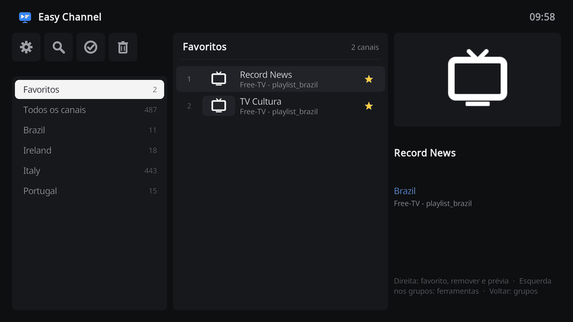<br>
  <sub>Easy Channel: troque de grupo, abra um canal que não responde e remova-o num passo só, com <b>Verificar o canal antes de abrir</b> ligado.</sub>
</p>

<p align="center">
  <a href="#instalação">Instalação</a> ·
  <a href="#add-ons">Add-ons</a> ·
  <a href="#ajuda-e-sugestões">Ajuda e sugestões</a> ·
  <a href="#apoie-o-projeto">Apoie o projeto</a> ·
  <a href="CONTRIBUTING.md">Como contribuir</a>
</p>

## Instalação

Registre o repositório **Monteiro** no Kodi uma vez, pelo endereço web, e todos os add-ons e atualizações passam a ser instalados por ele.

1. No Kodi, abra **Configurações > Sistema > Add-ons** e ligue **Fontes desconhecidas**.
2. Abra **Configurações > Gerenciador de arquivos > Adicionar fonte**, selecione **&lt;Nenhum&gt;**, digite `https://monteirohat.github.io/kodi-addons/`, dê o nome **Monteiro** à fonte e selecione **OK**.
3. Abra **Configurações > Add-ons > Instalar via arquivo zip > Monteiro** e selecione **repository.monteiromedia-1.0.5.zip**. Espere o aviso de que o repositório **Monteiro** foi instalado.
4. Abra **Instalar via repositório > Monteiro** e instale os add-ons que quiser. O Easy Channel e o Easy Movie ficam em **Add-ons de vídeo**, o HDMI Switcher, o Easy Files, o Easy Speed, o Easy Connect e o Easy Bluetooth em **Add-ons de programas**, o Easy Picture em **Add-ons de imagens** e o Easy Music em **Add-ons de música**.

As atualizações chegam pelo repositório. Se uma ainda não aparecer, abra o menu de contexto do **Monteiro** e selecione **Verificar atualizações**. Se o aparelho com Kodi estiver sem internet, baixe o ZIP na [última release](https://github.com/monteirohat/kodi-addons/releases/latest), copie para um pendrive e use **Instalar via arquivo zip**.

## Add-ons

<table>
  <tr>
    <td align="center" width="33%">
      <a href="script.m3u.channels/README.md"></a>
      <h3>Easy Channel</h3>
      TV ao vivo de listas M3U numa tela no estilo de TV box, que mantém só os canais que funcionam.
      <br><br>
      <a href="#easy-channel">Resumo</a> · <a href="script.m3u.channels/README.md">Guia</a>
    </td>
    <td align="center" width="33%">
      <a href="script.m3u.movies/README.md"></a>
      <h3>Easy Movie</h3>
      Os filmes e séries das suas listas M3U num catálogo de pôsteres, com temporadas e Continuar assistindo.
      <br><br>
      <a href="#easy-movie">Resumo</a> · <a href="script.m3u.movies/README.md">Guia</a>
    </td>
    <td align="center" width="33%">
      <a href="script.hdmi.switcher/README.md"></a>
      <h3>HDMI Switcher</h3>
      Escolha a tela HDMI ativa de um Raspberry Pi 4 direto pelo Kodi.
      <br><br>
      <a href="#hdmi-switcher">Resumo</a> · <a href="script.hdmi.switcher/README.md">Guia</a>
    </td>
  </tr>
  <tr>
    <td align="center" width="33%">
      <a href="script.easy.files/README.md"></a>
      <h3>Easy Files</h3>
      Um gerenciador de arquivos para o controle: copie, mova, renomeie e apague com um toque longo.
      <br><br>
      <a href="#easy-files">Resumo</a> · <a href="script.easy.files/README.md">Guia</a>
    </td>
    <td align="center" width="33%">
      <a href="script.easy.picture/README.md"></a>
      <h3>Easy Picture</h3>
      Suas fotos em galeria, por álbum, e cada uma em tela cheia com um toque no OK.
      <br><br>
      <a href="#easy-picture">Resumo</a> · <a href="script.easy.picture/README.md">Guia</a>
    </td>
    <td align="center" width="33%">
      <a href="skin.monteiro/README.md"></a>
      <h3>Skin Monteiro</h3>
      Uma tela inicial e menus no mesmo visual, com cada add-on Easy a um toque.
      <br><br>
      <a href="#skin-monteiro">Resumo</a> · <a href="skin.monteiro/README.md">Guia</a>
    </td>
  </tr>
  <tr>
    <td align="center" width="33%">
      <a href="script.easy.music/README.md"></a>
      <h3>Easy Music</h3>
      Suas músicas por playlist, uma para cada pasta, com a barra do player sempre à mão.
      <br><br>
      <a href="#easy-music">Resumo</a> · <a href="script.easy.music/README.md">Guia</a>
    </td>
    <td align="center" width="33%">
      <a href="script.monteiro.addons/README.md">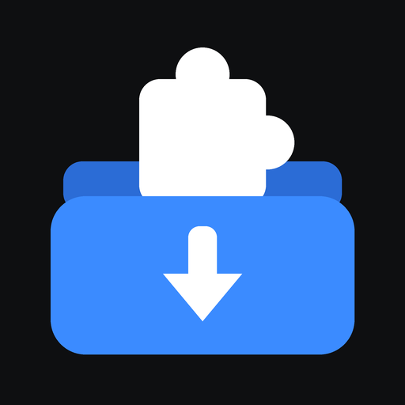</a>
      <h3>Monteiro Add-ons</h3>
      Todos os add-ons dos seus repositórios numa lista, com a categoria, os detalhes e as capturas de tela.
      <br><br>
      <a href="#skin-monteiro">Resumo</a> · <a href="script.monteiro.addons/README.md">Guia</a>
    </td>
    <td align="center" width="33%">
      <a href="script.easy.speed/README.md">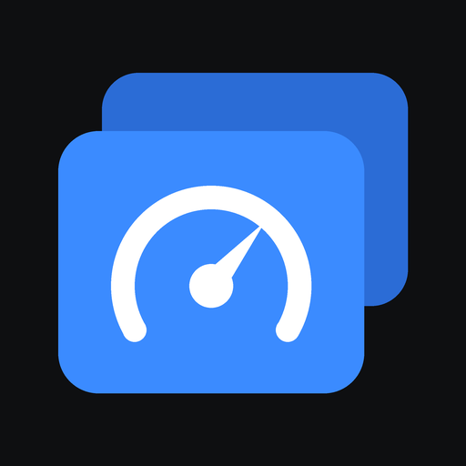</a>
      <h3>Easy Speed</h3>
      A velocidade da sua internet nos servidores do fast.com, e a verificação da conexão passo a passo.
      <br><br>
      <a href="#easy-speed">Resumo</a> · <a href="script.easy.speed/README.md">Guia</a>
    </td>
  </tr>
  <tr>
    <td align="center" width="33%">
      <a href="script.easy.connect/README.md">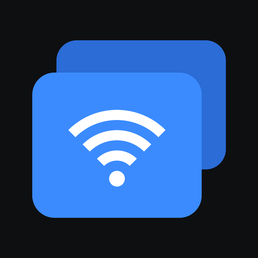</a>
      <h3>Easy Connect</h3>
      O Wi-Fi do LibreELEC: a rede atual com a senha, as redes ao alcance e as conhecidas.
      <br><br>
      <a href="#easy-connect">Resumo</a> · <a href="script.easy.connect/README.md">Guia</a>
    </td>
    <td align="center" width="33%">
      <a href="script.easy.bluetooth/README.md">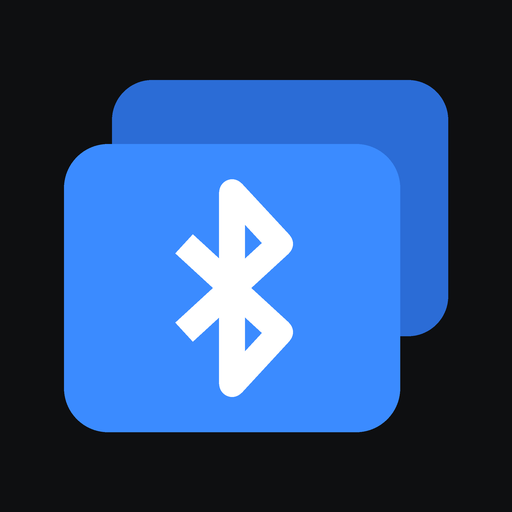</a>
      <h3>Easy Bluetooth</h3>
      Pareie e conecte fones, caixas de som, teclados e controles de jogo, com a bateria deles.
      <br><br>
      <a href="#easy-bluetooth">Resumo</a> · <a href="script.easy.bluetooth/README.md">Guia</a>
    </td>
  </tr>
</table>

### Easy Channel


**Adicione uma lista M3U em poucos passos, navegue pelos canais por grupo e remova os que param de funcionar assim que falham.** Não precisa configurar playlist nem EPG.

<br clear="left">

- Grupos à esquerda, canais no meio e os detalhes do canal em foco à direita.
- Listas por endereço web, por arquivo ou pelos arquivos M3U de um repositório do GitHub, com sugestões de repositórios de canais gratuitos e públicos.
- Quando um canal não abre, o Easy Channel oferece removê-lo, e **Verificar canais** testa um grupo inteiro de uma vez.
- Um grupo de **Favoritos** no topo, busca em todas as listas e exportação de um arquivo M3U limpo.
- Segure o **OK** num grupo para renomeá-lo ou excluí-lo.
- Selecionar **TV** no menu principal do Kodi abre o Easy Channel.

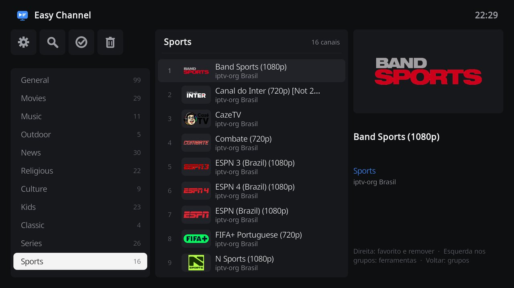

Leia o [guia do Easy Channel](script.m3u.channels/README.md) para conhecer cada recurso e ajuste. O guia está em inglês.

### Easy Movie


**Transforme os filmes e séries das suas listas M3U num catálogo de pôsteres.** Abra um filme para ver os detalhes, ou uma série para escolher a temporada e continuar de onde parou.

<br clear="left">

- Gêneros à esquerda e seis pôsteres por linha, com título e duração.
- Episódios agrupados em séries automaticamente, com temporadas, episódios, marca de assistido e um botão **Continuar**.
- Um grupo **Continuar assistindo**, e filmes e episódios retomam de onde você parou.
- Controles do player no estilo dos apps de streaming, com pulos de 10 segundos, legendas e faixas de áudio, e legendas do OpenSubtitles ligadas automaticamente no seu idioma.
- Listas por endereço web, por arquivo ou do GitHub, com um repositório sugerido de filmes em domínio público.
- O mesmo gerenciador de listas, verificação, favoritos e detecção de falhas do Easy Channel, no mesmo visual.
- Pastas com os seus próprios vídeos, no cartão SD, em pendrives ou em compartilhamentos de rede, com pôsteres e detalhes do Cinemeta.
- Os filmes e séries do Cinemeta e dos addons do Stremio adicionados pelo endereço, na mesma tela das suas listas, cujas fontes vão para um gerenciador de downloads de torrent ou tocam na hora. O que já foi baixado abre com um check verde.
- Com a biblioteca vazia, selecionar **Filmes** ou **Seriados** no menu principal do Kodi abre o Easy Movie.

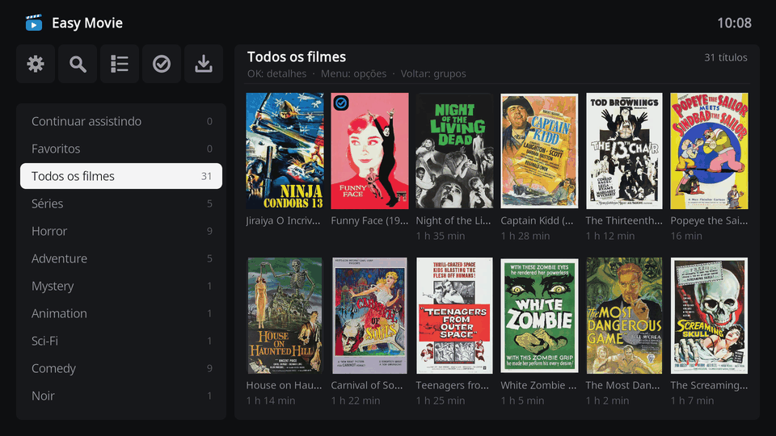

Leia o [guia do Easy Movie](script.m3u.movies/README.md) para conhecer cada recurso e ajuste. O guia está em inglês.

### HDMI Switcher


**Alterne entre uma tela HDMI pequena e um monitor externo sem usar a linha de comando.** Escolha a tela, e o Kodi reinicia nela.

<br clear="left">

- Dois cartões de tela que mostram qual está ativa e quais estão conectadas, no mesmo visual escuro do Easy Channel e do Easy Movie.
- Feito para o LibreELEC no Raspberry Pi 4, com a tela pequena em `HDMI-A-1` e o monitor externo em `HDMI-A-2`.
- Mantém as suas configurações avançadas e faz uma cópia do arquivo de configuração antes da primeira mudança.
- Lembra a tela escolhida nas próximas vezes que o Kodi iniciar.

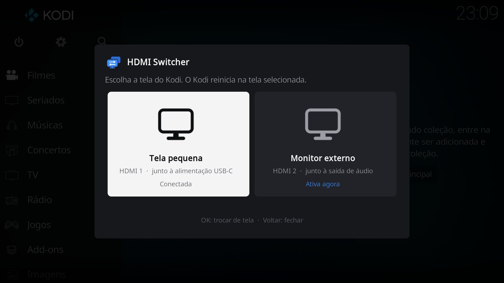

O HDMI Switcher precisa de uma [configuração única](script.hdmi.switcher/README.md#one-time-setup), que remove ajustes antigos de HDMI na inicialização. Leia o [guia do HDMI Switcher](script.hdmi.switcher/README.md) para os detalhes. O guia está em inglês.

### Easy Files


**Um gerenciador de arquivos para o controle remoto.** Os locais à esquerda, a pasta à direita e todas as opções a um toque longo.

<br clear="left">

- A sua pasta pessoal, pendrives, compartilhamentos de rede e as pastas do Kodi, com o espaço livre de cada disco.
- Segure o **OK** num arquivo ou pasta para abrir, renomear, copiar, mover ou apagar, criar uma pasta ou ver os detalhes.
- As cópias mostram o progresso e podem ser canceladas.

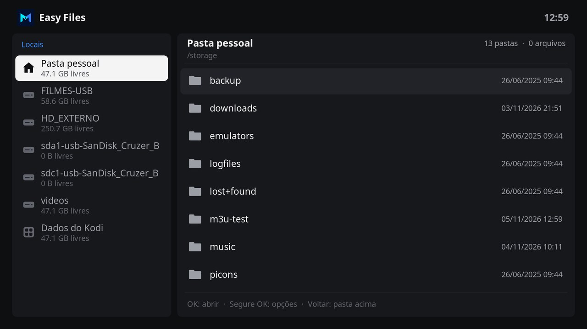

Leia o [guia do Easy Files](script.easy.files/README.md) para conhecer cada recurso. O guia está em inglês.

### Easy Picture


**Suas fotos na TV, em galeria.** Os álbuns à esquerda, as fotos do álbum à direita e cada foto em tela cheia com um toque no OK.

<br clear="left">

- Todas as imagens e as suas favoritas primeiro, e depois um álbum para cada pasta de fotos.
- Esquerda e Direita passam as fotos em tela cheia.
- Segure o **OK** numa foto para marcá-la como favorita, girá-la ou espelhá-la, ou ver a data, o tamanho, a resolução e a pasta.

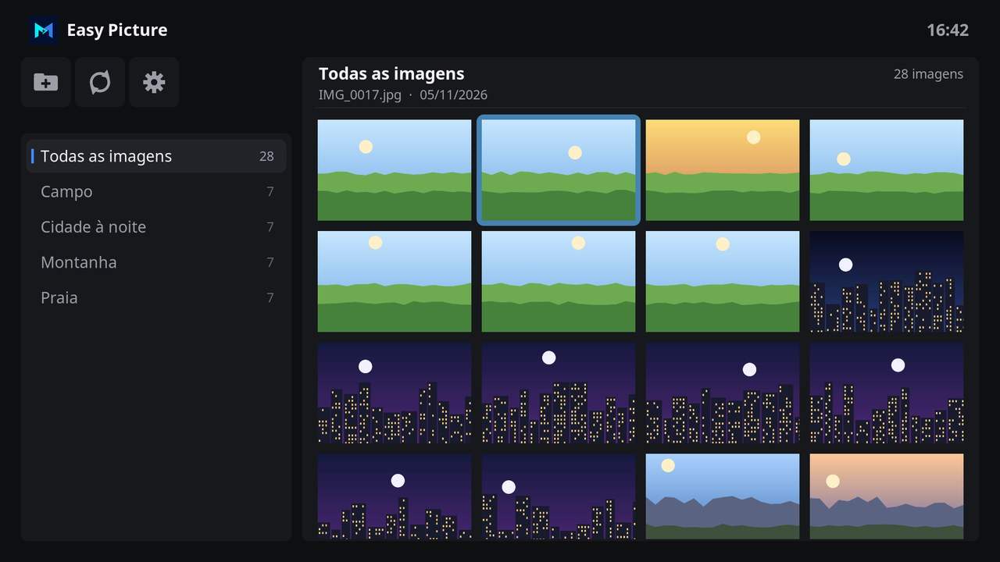

Leia o [guia do Easy Picture](script.easy.picture/README.md) para conhecer cada recurso. O guia está em inglês.

### Easy Music


**Suas músicas por playlist, com o player sempre à mão.** As playlists à esquerda, as músicas à direita e o player numa barra embaixo.

<br clear="left">

- Uma playlist para cada pasta de músicas, com Todas as músicas e as suas curtidas primeiro.
- A barra do player tem a capa, o título e o artista, tocar e pausar, anterior e próxima, aleatório, repetir, um coração e o progresso da música.
- Segure o **OK** numa música para tocá-la em seguida, adicioná-la à fila, curti-la ou ver os detalhes. A música continua tocando quando o Easy Music fecha.

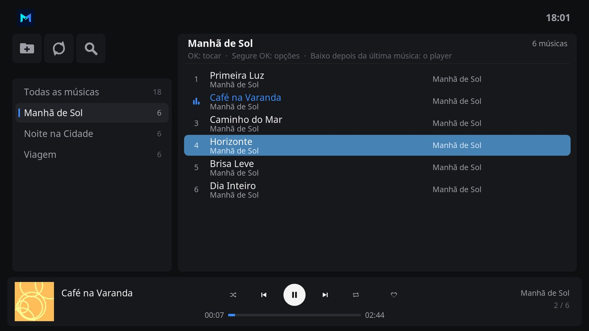

Leia o [guia do Easy Music](script.easy.music/README.md) para conhecer cada recurso. O guia está em inglês.

### Easy Speed


**A velocidade da sua internet, no aparelho que toca os seus vídeos.** Um velocímetro mostra a velocidade enquanto ela é medida, nos servidores do fast.com, o teste de velocidade da Netflix.

<br clear="left">

- Download, upload, latência e latência com a conexão em uso, com a qualidade de vídeo que a conexão aguenta sem travar.
- **Conexão** verifica a rede, o roteador, o DNS e a internet, um depois do outro, e diz onde está o problema e o que fazer.
- O tipo de conexão, o sinal do Wi-Fi e os últimos testes num histórico.

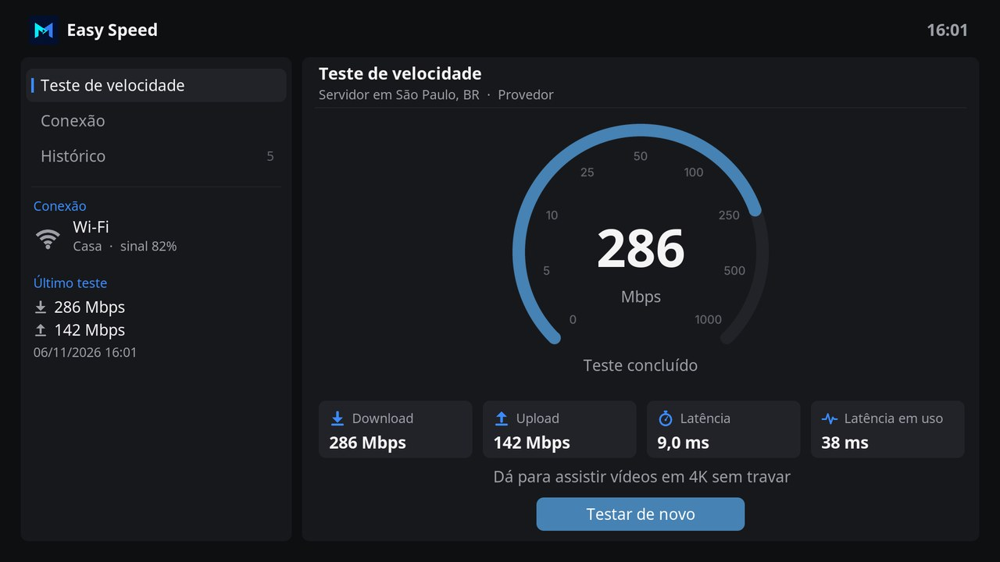

Leia o [guia do Easy Speed](script.easy.speed/README.md) para conhecer cada recurso. O guia está em inglês.

### Easy Connect


**O Wi-Fi do LibreELEC, do sofá.** A rede em que o aparelho está conectado, as redes ao alcance e as conhecidas, cada uma na sua seção.

<br clear="left">

- A rede atual com o sinal, a frequência e o canal, a velocidade do link, a segurança, os endereços e a senha salva, que só aparece quando você pede.
- As redes ao alcance com o sinal e um cadeado nas que têm senha. O **OK** conecta e pede a senha numa rede nova.
- As redes conhecidas, ao alcance ou não, para conectar, ver a senha, escolher se cada uma conecta sozinha ou esquecê-la. Um botão liga e desliga o Wi-Fi.

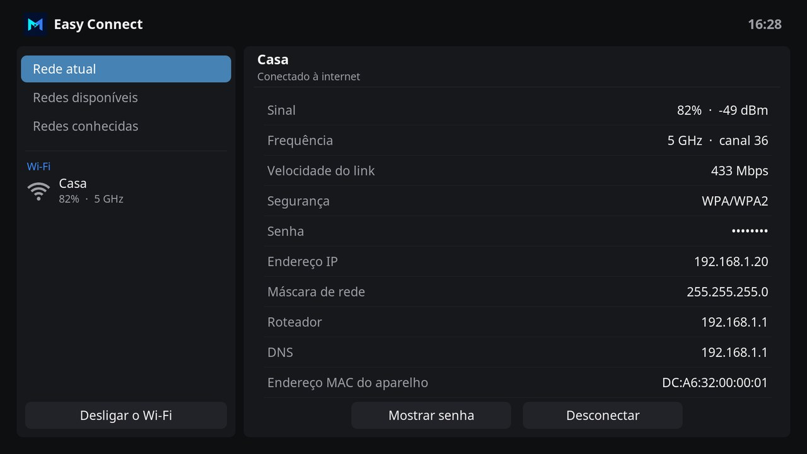

Leia o [guia do Easy Connect](script.easy.connect/README.md) para conhecer cada recurso. O guia está em inglês.

### Easy Bluetooth


**Fones, caixas de som, teclados e controles de jogo, sem fios.** Os dispositivos pareados e os que estão por perto, cada um na sua seção.

<br clear="left">

- Os dispositivos pareados com o tipo, se estão conectados e a bateria. O **OK** num deles abre um modal para conectar ou desconectar, escolher se ele conecta sozinho ou esquecê-lo.
- **Procurar dispositivos** lista os dispositivos com nome por perto, com o sinal. O **OK** pareia, confia e conecta um dispositivo, pedindo um código quando ele precisa.
- Um botão liga e desliga o Bluetooth, e o skin Monteiro abre o Easy Bluetooth pela tela inicial.

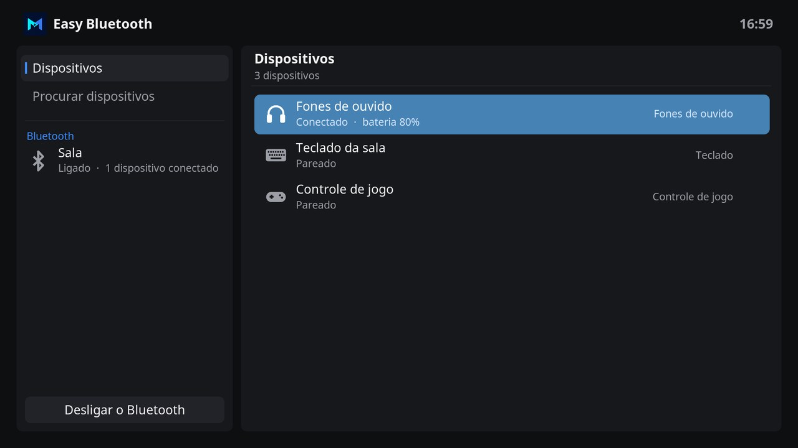

Leia o [guia do Easy Bluetooth](script.easy.bluetooth/README.md) para conhecer cada recurso. O guia está em inglês.

> [!NOTE]
> O Easy Channel e o Easy Movie não oferecem nenhum conteúdo. Eles tocam as listas M3U que você adiciona, e você é responsável por usar só listas que tem permissão para assistir. Os repositórios sugeridos do GitHub reúnem canais gratuitos e públicos e filmes em domínio público, e são mantidos por terceiros.

## Skin Monteiro

Um skin para o Kodi no visual dos add-ons, sob a licença MIT. A tela inicial abre direto os add-ons Easy, e as configurações, menus, teclado e barras do player seguem o mesmo visual escuro, com o foco em azul aço. Instale em **Monteiro > Aparência > Skin**.

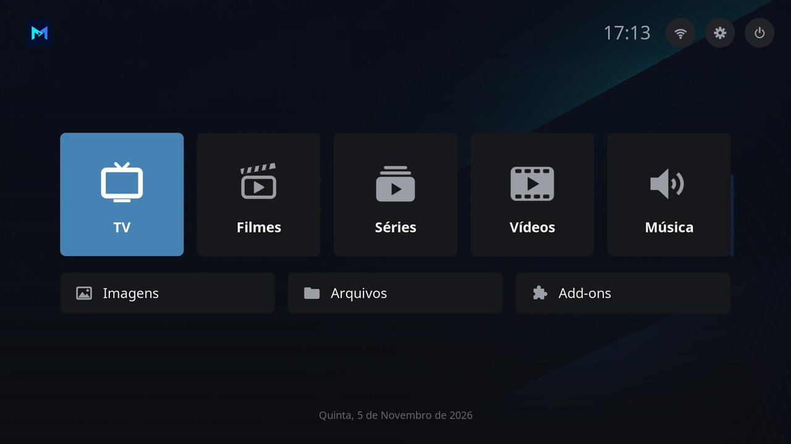

- **TV**, **Filmes** e **Séries** abrem o Easy Channel e o Easy Movie, **Música** abre o Easy Music, **Imagens** abre o Easy Picture, **Arquivos** abre o Easy Files e **Velocidade** abre o Easy Speed. Sem o add-on, o item oferece a instalação.
- **Vídeos** abre as fontes do Kodi, e **Add-ons** abre os add-ons instalados, com uma barra para busca, repositórios e atualizações. **Repositórios** lista os add-ons de cada repositório com as categorias, pelo [Monteiro Add-ons](script.monteiro.addons/README.md), que o skin instala junto.
- Os botões no canto superior direito abrem o Easy Bluetooth, o Easy Connect, cujo ícone mostra o sinal do Wi-Fi, as configurações do Kodi e o menu de energia.

Leia o [guia do skin](skin.monteiro/README.md), em inglês, para conhecer cada tela.

## Ajuda e sugestões

- Encontrou um problema? Abra um [relato de bug](https://github.com/monteirohat/kodi-addons/issues/new?template=bug_report.yml).
- Tem uma ideia? Abra uma [sugestão](https://github.com/monteirohat/kodi-addons/issues/new?template=feature_request.yml).
- Dúvidas, dicas e listas que funcionam bem ficam nas [Discussions](https://github.com/monteirohat/kodi-addons/discussions).

Os formulários de bug e de sugestão estão em inglês, mas você pode escrever em português.

Para montar o repositório, publicar atualizações ou mudar um add-on, leia o [CONTRIBUTING.md](CONTRIBUTING.md), em inglês.

## Apoie o projeto

Os add-ons são gratuitos e vão continuar gratuitos. Se eles são úteis para você e você quiser apoiar o projeto, qualquer valor ajuda.

<p>
  <a href="#apoie-o-projeto"></a>
  <a href="https://revolut.me/andrludegv"></a>
</p>

- **PIX**: use esta chave aleatória no app do seu banco.

  ```
  abf3de6b-bad4-4225-8667-c941ebd31039
  ```

- **Revolut**, de qualquer país: abra [revolut.me/andrludegv](https://revolut.me/andrludegv), ou envie para a tag **@andrludegv** no app.

## Licença

MIT. Veja [LICENSE](LICENSE).
