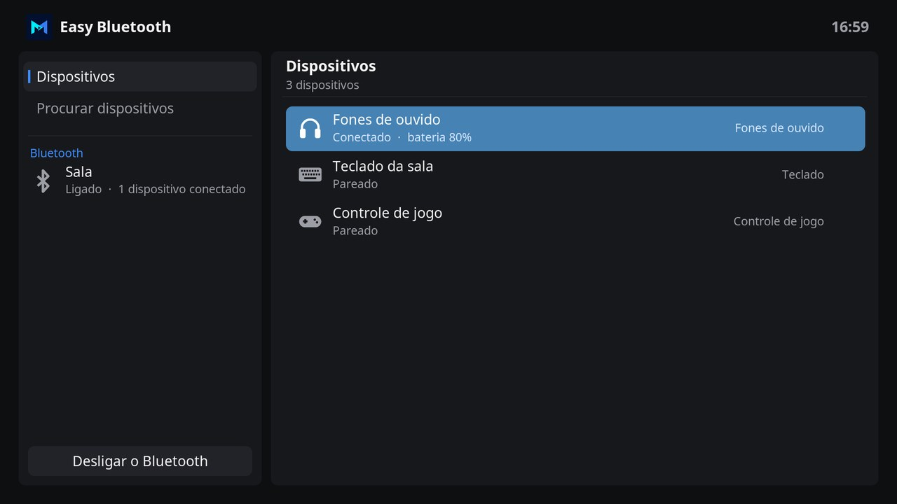
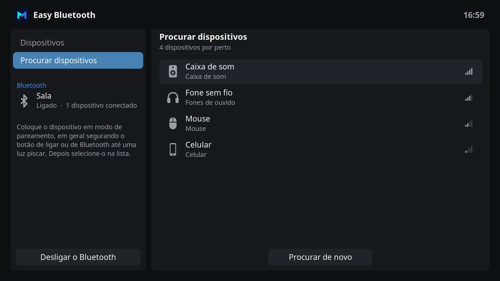

# Easy Bluetooth

Easy Bluetooth pairs and connects headphones, speakers, keyboards, mice and game controllers in the design of Easy Channel, Easy Connect and the Monteiro skin. The paired devices and the devices nearby each have a section, and a button turns the Bluetooth on and off.

## Features

- **Devices**: the paired devices, the connected ones first. Each one shows the icon of its kind, whether it is connected or only paired, and its battery when the device reports it.
- **OK** on a device opens a modal with its kind and address, and buttons to **Connect** or **Disconnect** it, choose whether it **connects by itself** when it turns on, or **forget** it, which asks first.
- **Search for devices**: the devices nearby that have a name, strongest first, with the icon of their kind and bars for their signal. The search goes on while it shows, and **Search again** starts it over.
- **OK** on a device nearby pairs it, trusts it so it connects by itself, and connects it. When the device asks for a code, Easy Bluetooth asks too: it shows a code to compare with the one on the device, asks for a PIN, or shows a code to type on a keyboard.
- On the left, the name of the Bluetooth of this device, whether it is on and how many devices are connected, and the button that turns the Bluetooth off, which asks first when a device is connected, or on.
- When the Bluetooth service of LibreELEC is off, Easy Bluetooth offers to turn it on.
- Interface in English and Brazilian Portuguese.

## Pairing a device

1. Put the device in pairing mode, usually by holding its power or Bluetooth button until a light blinks.
2. Open **Search for devices** and wait for its name.
3. Select it. Answer the question of the device, if it asks one, and wait for the message that it is paired and connected.

Headphones and speakers show as audio devices of Kodi. To hear the sound through them, choose them in **Settings > System > Audio > Audio output device**.

## Using Easy Bluetooth

| Key | On the sections | On the right |
| --- | --- | --- |
| **Up / Down** | Move between Devices and Search for devices. Down after the last one reaches the Bluetooth button. | Move between devices. Down after the last device nearby reaches **Search again**. |
| **Right / OK** | Move to the section. | Open the options of a paired device, or pair a device nearby. |
| **Left** | | Return to the sections. |
| **Back** | Close Easy Bluetooth. | Return to the sections. |

## With the Monteiro skin

The Bluetooth button at the top right of the home screen of the Monteiro skin, next to Wi-Fi, opens Easy Bluetooth, or offers to install it.

## Requirements

Easy Bluetooth uses BlueZ, the Bluetooth of Linux, and its command line tool `bluetoothctl`, which LibreELEC includes.

## Development

| Path | Purpose |
| --- | --- |
| `default.py` | Opens the main window. |
| `resources/lib/gui.py` | Main window, the modal of a device and pairing. |
| `resources/lib/bluetooth.py` | BlueZ: the adapter, the devices and their details, connecting, trusting, forgetting, searching and pairing. It does not import Kodi modules: `python3 resources/lib/bluetooth.py` searches for 10 seconds and prints what it found. |
| `resources/skins/default/` | Window layouts and icons. |

Searching and pairing run `bluetoothctl` in a pseudo terminal with its agent on, which reports the devices as they appear and asks the questions of pairing. Kodi runs add-ons in subinterpreters, where `os.fork` is not allowed, so the terminal is started with `subprocess`.

The window layouts are generated by `tools/generate_easy_bluetooth_skin.py`, with the palette and parts of the Easy Channel generator. The icon, fanart, header symbol and the icons are drawn by `tools/generate_easy_bluetooth_art.py`, which needs Pillow and the [Inter](https://rsms.me/inter/) font. The screenshots show sample devices.

## License

MIT. See [LICENSE](LICENSE).
