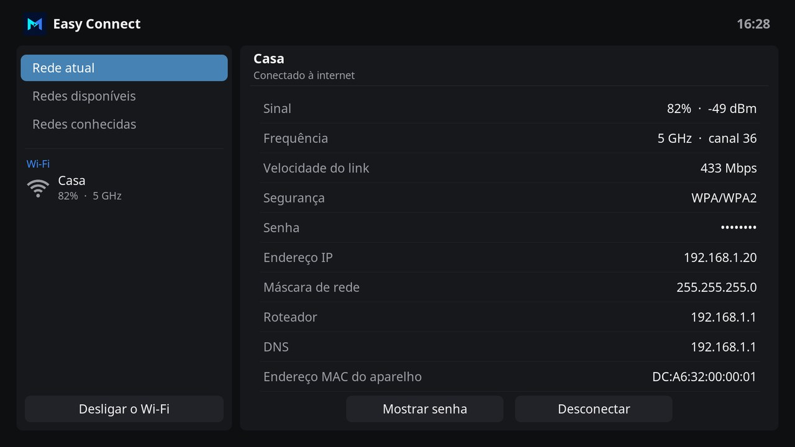
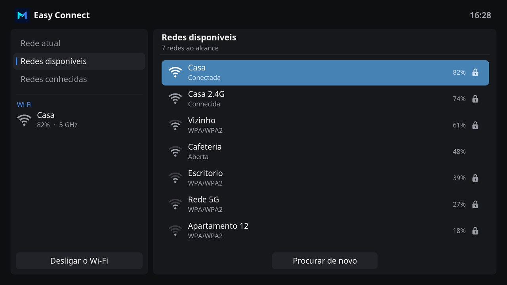

# Easy Connect

Easy Connect manages the Wi-Fi of LibreELEC in the design of Easy Channel, Easy Movie and the Monteiro skin. The network the device is connected to, the networks in range and the known networks each have a section, and a button turns the Wi-Fi on and off.

## Features

- **Current network**: the name of the network and whether it reaches the internet, its signal in percent and dBm, its frequency and channel, the speed of the link, the security, the IP address, subnet mask, router and DNS, and the MAC address of the device.
- The saved password shows as dots. **Show password** shows it, and it hides again when you leave the section. **Disconnect** asks first.
- **Available networks**: the networks in range, the connected one first, then the known ones, then by signal. Each one shows its signal, a lock when it has a password, and whether it is connected or known. The list looks for networks again every 20 seconds while it shows, and **Search again** looks at once.
- **OK** on a network connects to it. A known network connects with its saved password, and a new one asks for its password on the keyboard. When the device is connected to another network, Easy Connect asks first, as it leaves that network.
- **Known networks**: every network connman keeps, in range or not. **OK** on one opens its details, with its signal, state, password and security, and buttons to connect to it, show its password, choose whether it connects by itself, or forget it and its password.
- On the left, the network of the device with its signal and band, and the button that turns the Wi-Fi off, which asks first, or on.
- Interface in English and Brazilian Portuguese.

## Using Easy Connect

| Key | On the sections | On the right |
| --- | --- | --- |
| **Up / Down** | Move between Current network, Available networks and Known networks. Down after the last one reaches the Wi-Fi button. | Move between networks. Down after the last available network reaches **Search again**. |
| **Right / OK** | Move to the section. | Connect to a network, or open the options of a known network. |
| **Left** | | Return to the sections. |
| **Menu** (**C** on a keyboard) | | Options of the network: connect, or forget a known one. |
| **Back** | Close Easy Connect. | Return to the sections. |

## With the Monteiro skin

The Wi-Fi button at the top right of the home screen of the Monteiro skin opens Easy Connect, or offers to install it on LibreELEC. While Easy Connect is installed, a service keeps the icon of that button up to date every 10 seconds: one to three arcs for the Wi-Fi signal, a cable for a wired connection, or a crossed icon without a connection.

## Requirements

Easy Connect uses connman, the network manager of LibreELEC, and its command line tool `connmanctl`. Networks with the enterprise login of a company, WPA Enterprise, connect in the settings of LibreELEC.

## Development

| Path | Purpose |
| --- | --- |
| `default.py` | Opens the main window. |
| `service.py` | Keeps the icon of the connection for the home screen of the Monteiro skin, in the window property `EasyConnect.Icon` of the home screen. |
| `resources/lib/gui.py` | Main window, sections, connecting and the known networks. |
| `resources/lib/wifi.py` | connman: the networks, their details and passwords, connecting, forgetting and the Wi-Fi switch. It does not import Kodi modules: `python3 resources/lib/wifi.py` prints what the window shows, without the passwords. |
| `resources/lib/status.py` | The icon of the connection, read from `/proc` and `/sys`. |
| `resources/skins/default/` | Window layout and icons. |

connman keeps each known network in a folder of its storage, `/storage/.cache/connman` on LibreELEC, with a settings file that holds its name, whether it connects by itself and its password. Connecting to a new network with a password needs an agent that answers the question of connman; `wifi.py` runs `connmanctl` in a pseudo terminal with its agent on, and answers it.

The window layout is generated by `tools/generate_easy_connect_skin.py`, with the palette and parts of the Easy Channel generator. The icon, fanart, header symbol and the icons are drawn by `tools/generate_easy_connect_art.py`, which needs Pillow and the [Inter](https://rsms.me/inter/) font. The screenshots show sample networks.

## License

MIT. See [LICENSE](LICENSE).
