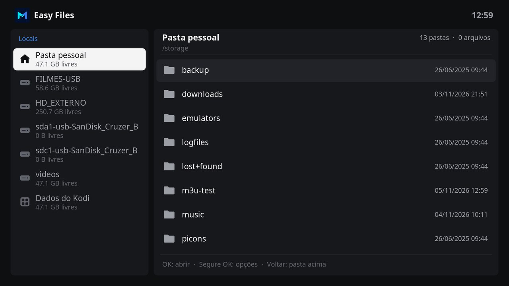

# Easy Files

Easy Files is a file manager for Kodi made for the remote control, in the design of Easy Channel, Easy Movie and the Monteiro skin. Places are on the left, and the folder you open is on the right, with an icon for each kind of file, its size and its date.

## Features

- Places: your home folder, USB drives and hard drives, the network shares added to Kodi, and the data folder of Kodi, with the free space of each drive.
- OK opens a folder, plays a video or a song, shows a picture or a text file, and opens a ZIP file as a folder.
- Hold OK on a file or folder for its options: **Open**, **Information**, **Rename**, **Copy**, **Move**, **Delete** and **New folder**.
- **Information** shows the kind, size, contents, date, location and free space of the drive. The size of a folder is added up while the window is open.
- Copies show their progress and can be cancelled. A name that already exists can be replaced, or both kept.
- Interface in English and Brazilian Portuguese.

## Using Easy Files

| Key | On the places | On a file or folder |
| --- | --- | --- |
| **Up / Down** | Move between places. | Move between files and folders. |
| **OK** | Open the place. | Open the folder or the file. |
| **Right / Left** | Move to the folder. | Return to the places. |
| **Hold OK**, or **Menu** (**C** on a keyboard) | Options of the folder shown, such as **Paste here** and **New folder**. | Options of the file or folder. |
| **Back** | Close Easy Files. | Go to the folder above. At the top of a place, return to the places. |

### Copying and moving

1. Hold OK on a file or folder and select **Copy**, or **Move**.
2. Open the destination folder. The bottom of the window shows what is waiting to be pasted.
3. Hold OK in the folder and select **Paste here**.

A move within the same drive is instant. Between drives, the files are copied and then deleted from where they were.

### Deleting

**Delete** asks for confirmation. A folder is deleted with everything in it. Deleted files do not go to a trash folder and cannot be restored.

## Settings

| Setting | Default | Purpose |
| --- | --- | --- |
| Show hidden files | Off | Show files and folders whose name starts with a dot. |

## With the Monteiro skin

**Files** on the home screen of the Monteiro skin, and **File manager** in its settings, open Easy Files when it is installed.

## Development

| Path | Purpose |
| --- | --- |
| `default.py` | Opens the main window. |
| `resources/lib/gui.py` | Main window, options of files and folders, copying and the details window. |
| `resources/lib/files.py` | Kinds, sizes, natural order and names of files. It does not import Kodi modules and can be tested with a regular Python 3 interpreter. |
| `resources/skins/default/` | Window layouts and icons. |

The window layouts are generated by `tools/generate_easy_files_skin.py`, with the palette and parts of the Easy Channel generator. The icon, fanart, header symbol and file icons are drawn by `tools/generate_easy_files_art.py`, which needs Pillow and the [Inter](https://rsms.me/inter/) font.

## License

MIT. See [LICENSE](LICENSE).
