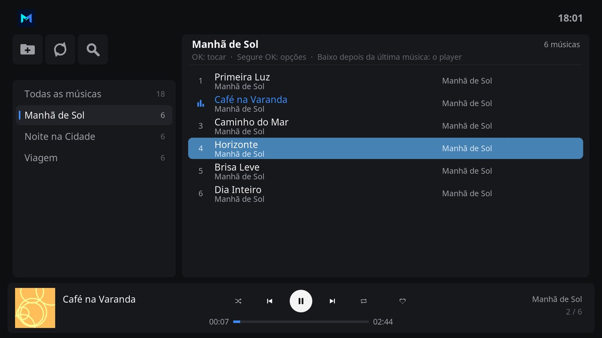

# Easy Music

Easy Music plays the music of your folders in the design of Easy Channel, Easy Movie and the Monteiro skin. The playlists are on the left, the songs of the playlist are on the right, and the player is in a bar at the bottom.

## Features

- **All songs** first, then **Liked songs**, then one playlist for each folder that holds songs.
- Each song shows its number, title, artist and album, read from its tags, or from its file name when it has none. The song that plays shows moving bars and its title in blue.
- The player bar shows the cover, title and artist of the song, its album and place in the queue, the time and the progress, and the buttons **Shuffle**, **Previous**, **Play** and **Pause**, **Next**, **Repeat** (all songs, or one) and a heart that likes the song that plays.
- Hold OK on a song to play it, play it next, add it to the queue, like it, or see its details.
- Search looks for words in the titles, artists and albums of every song.
- The music goes on when Easy Music closes, and the play and pause keys of the remote work everywhere.
- Interface in English and Brazilian Portuguese.

## Adding your music

The first time Easy Music opens, it uses the music sources of Kodi. To add or remove folders:

1. Select the folder button at the top left, above the playlists.
2. Select **Add a folder** and choose the folder with your music, on a USB drive, a hard drive or a network share. Its subfolders become playlists.
3. To stop showing a folder, select it in the same list. The songs stay in the folder.

Select the arrows button to look for songs added to the folders since Easy Music opened.

## Using Easy Music

| Key | On the playlists | On the songs | On the player |
| --- | --- | --- | --- |
| **Up / Down** | Move between playlists. Down after the last one reaches the player. | Move between songs. Down after the last one reaches the player. | Up returns to the songs. |
| **Left / Right** | Left reaches the toolbar. Right moves to the songs. | Left returns to the playlists. | Move between the buttons. |
| **OK** | Show the songs of the playlist. | Play the playlist from this song. | Press the button. **Play** starts the playlist shown when nothing plays. |
| **Hold OK**, or **Menu** (**C** on a keyboard) | | Options of the song. | |
| **Back** | Close Easy Music. The music goes on. | Return to the playlists. | Return to the songs. |

## With the Monteiro skin

**Music** on the home screen of the Monteiro skin opens Easy Music when it is installed.

## Development

| Path | Purpose |
| --- | --- |
| `default.py` | Opens the main window. |
| `resources/lib/gui.py` | Main window, folders, liked songs, the queue and the player bar. |
| `resources/lib/music.py` | Kinds, natural order and covers of songs, and their ID3 and FLAC tags. It does not import Kodi modules and can be tested with a regular Python 3 interpreter. |
| `resources/skins/default/` | Window layout and icons. |

The window layout is generated by `tools/generate_easy_music_skin.py`, with the palette and parts of the Easy Channel generator. The icon, fanart, header symbol and the icons of the toolbar and the player are drawn by `tools/generate_easy_music_art.py`, which needs Pillow and the [Inter](https://rsms.me/inter/) font. The screenshot shows sample playlists made for it, with silent songs.

## License

MIT. See [LICENSE](LICENSE).
