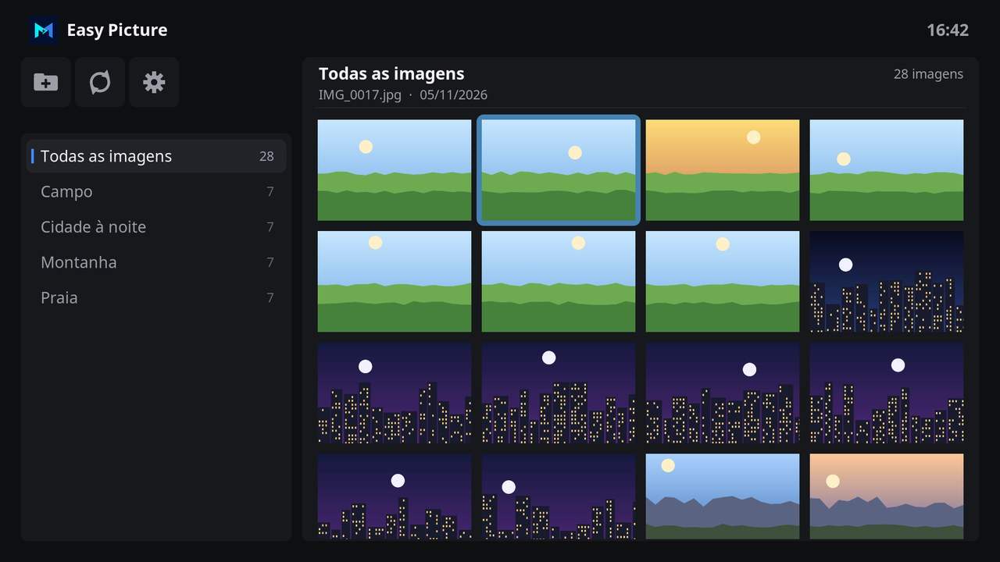
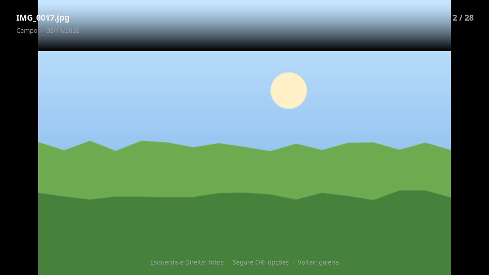

# Easy Picture

Easy Picture shows your photos on the TV in the design of Easy Channel, Easy Movie, Easy Files and the Monteiro skin. The albums are on the left, and the pictures of the album are on the right, in a gallery.

## Features

- **All pictures** first, newest first, then **Favorites**, then one album for each folder that holds pictures.
- OK shows a picture in full screen. **Left** and **Right** move to the previous and next pictures of the album.
- Hold OK on a picture to add it to the favorites or remove it, or to see its details: date, size, resolution and folder.
- Hold OK on a picture to rotate it 90 degrees to the right or left, or flip it horizontally or vertically. The picture shows that way in the gallery and in full screen, and the file does not change. **Original position** undoes it.
- Album covers, folder pictures and other artwork that music and video players leave in folders are left out.
- Interface in English and Brazilian Portuguese.

## Adding your photos

The first time Easy Picture opens, it uses the picture sources of Kodi. To add or remove folders:

1. Select the folder button at the top left, above the albums.
2. Select **Add a folder** and choose the folder with your photos, on a USB drive, a hard drive or a network share. Its subfolders become albums.
3. To stop showing a folder, select it in the same list. The pictures stay in the folder.

Select the arrows button to look for pictures added to the folders since Easy Picture opened.

## Using Easy Picture

| Key | On the albums | On the gallery | In full screen |
| --- | --- | --- | --- |
| **Up / Down** | Move between albums. | Move between rows. | Show the name, album, date and position of the picture. |
| **Left / Right** | Left reaches the toolbar. Right moves to the gallery. | Move between pictures. Left in the first column returns to the albums. | Previous and next picture. |
| **OK** | Show the pictures of the album. | Show the picture in full screen. | Show the details of the picture. |
| **Hold OK**, or **Menu** (**C** on a keyboard) | | Options of the picture. | Options of the picture. |
| **Back** | Close Easy Picture. | Return to the albums. | Return to the gallery. |

## Settings

| Setting | Default | Purpose |
| --- | --- | --- |
| Order of all pictures | Newest first | Order of **All pictures**: newest first, or by album and name. Albums are always in name order. |

## With the Monteiro skin

**Pictures** on the home screen of the Monteiro skin opens Easy Picture when it is installed.

## Development

| Path | Purpose |
| --- | --- |
| `default.py` | Opens the main window. |
| `resources/lib/gui.py` | Main window, folders, favorites and the picture in full screen. |
| `resources/lib/pictures.py` | Kinds, natural order, sizes and dimensions of pictures, and the names of albums. It does not import Kodi modules and can be tested with a regular Python 3 interpreter. |
| `resources/skins/default/` | Window layouts and icons. |

The window layouts are generated by `tools/generate_easy_picture_skin.py`, with the palette and parts of the Easy Channel generator. The icon, fanart, header symbol and toolbar icons are drawn by `tools/generate_easy_picture_art.py`, which needs Pillow and the [Inter](https://rsms.me/inter/) font. The screenshots show sample pictures drawn for them.

## License

MIT. See [LICENSE](LICENSE).
