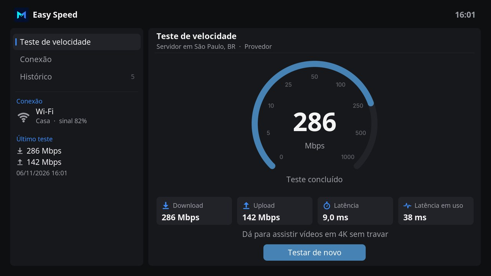
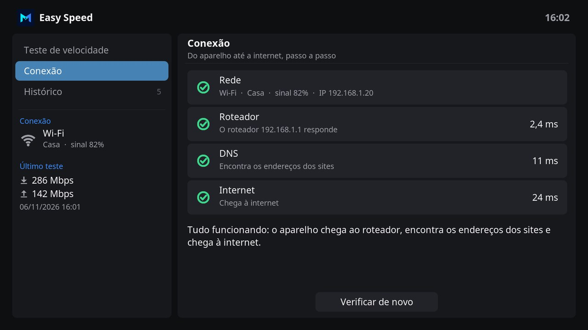

# Easy Speed

Easy Speed tests the internet of the device that plays your videos, in the design of Easy Channel, Easy Movie and the Monteiro skin. A speedometer shows the speed as it is measured, and the connection is checked step by step, from the network to the internet.

## Features

- The test starts when Easy Speed opens. It measures the **latency**, the **download** and the **upload**, and the **latency in use**, the latency while the connection is busy, which grows when the router holds too much data.
- The speedometer goes from 0 to 1000 Mbps and moves with the speed of the last two seconds. The result of each phase leaves out its first two seconds, while the connection grows to its speed.
- Under the results, the video quality the connection plays without stopping: 4K from 15 Mbps, Full HD from 5, HD from 3, and standard quality from 1, as Netflix recommends.
- The test uses the servers of [fast.com](https://fast.com), the speed test of Netflix, which are the servers that deliver its videos. When fast.com does not answer, it uses the servers of Cloudflare.
- **Connection** checks the network, the router, the DNS and the internet, one after the other, and says where a problem is and what to do. When the internet does not work, Easy Speed opens there instead of testing.
- On the left, the kind of connection, the name of the Wi-Fi network and its signal, or the speed of the cable, and the last test.
- **History** keeps the last 50 tests. Press OK on a test to delete it, or the whole history.
- Interface in English and Brazilian Portuguese.

## The checks of the connection

| Check | Passes when | When it fails |
| --- | --- | --- |
| **Network** | The device has an address on a network, by cable or Wi-Fi. A Wi-Fi signal under 40% shows a warning. | Connect a network cable, or choose a Wi-Fi network in the settings of the system. |
| **Router** | The router answers. Some routers answer nothing, and then the check passes when the internet works. | Turn the router off and on again, and check its cables. |
| **DNS** | The device finds the address of fast.com. | The internet provider may be down. |
| **Internet** | A page of Google that answers with nothing answers as expected. Another page in its place, as the login of a hotel network, shows a warning. | The internet provider may be down. |

## Using Easy Speed

| Key | On the sections | On the right |
| --- | --- | --- |
| **Up / Down** | Move between Speed test, Connection and History. | Move between tests in History. |
| **Right / OK** | Move to the section. | **OK** on the button starts or stops the test, or checks the connection again. |
| **Left** | | Return to the sections. |
| **OK** on a test, or **Menu** (**C** on a keyboard) | | Delete the test, or the whole history. |
| **Back** | Close Easy Speed. A test in progress stops. | Return to the sections. |

## With the Monteiro skin

**Speed** on the home screen of the Monteiro skin, next to **Add-ons**, opens Easy Speed when it is installed. With the Monteiro skin, the speed shows in a larger font.

## Development

| Path | Purpose |
| --- | --- |
| `default.py` | Opens the main window. |
| `resources/lib/gui.py` | Main window, sections, speedometer and history. |
| `resources/lib/speed.py` | The speed test, on the servers of fast.com or Cloudflare. It does not import Kodi modules: `python3 resources/lib/speed.py` runs a test in a terminal. |
| `resources/lib/network.py` | The checks of the connection. It does not import Kodi modules: `python3 resources/lib/network.py` prints them. |
| `resources/skins/default/` | Window layout, speedometer and icons. |

fast.com has no official API. Like its page, `speed.py` reads a token from the script of the page and asks for the addresses of the nearest servers, each time a test starts, so a new token does not break it.

The window layout is generated by `tools/generate_easy_speed_skin.py`, with the palette and parts of the Easy Channel generator. The icon, fanart, header symbol, the speedometer and the icons are drawn by `tools/generate_easy_speed_art.py`, which needs Pillow and the [Inter](https://rsms.me/inter/) font. The screenshots show sample results.

## License

MIT. See [LICENSE](LICENSE).
