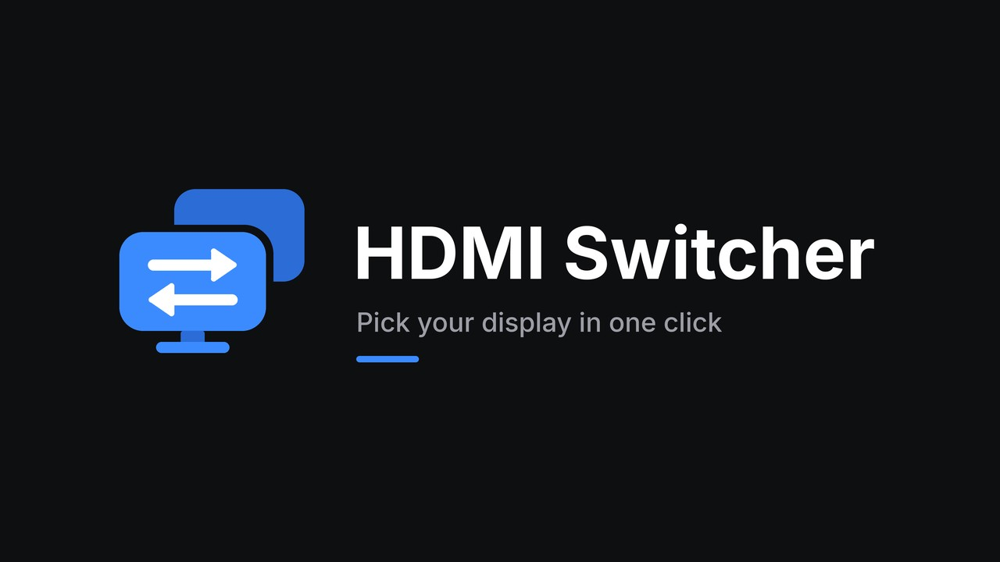
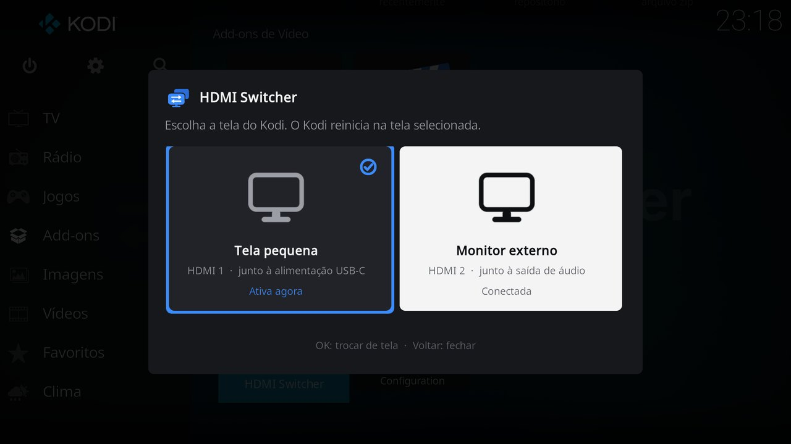

# HDMI Switcher

A Kodi program add-on for selecting the active HDMI display on LibreELEC for Raspberry Pi 4. Pick a display from two cards, confirm, and Kodi restarts on it. It shares the dark design of [Easy Channel](../script.m3u.channels/README.md) and [Easy Movie](../script.m3u.movies/README.md).



## Display mapping

| Card | Connector | Raspberry Pi 4 port |
| --- | --- | --- |
| Small display | `HDMI-A-1` | `HDMI0`, nearest the USB-C power connector |
| External monitor | `HDMI-A-2` | `HDMI1`, nearest the audio jack |

The labels match the confirmed Raspberry Pi installation. To use a different arrangement, change the connectors in `DISPLAYS` in `default.py` and the card names in `resources/language/*/strings.po`.

## Requirements

- LibreELEC on Raspberry Pi 4. Target environment is LibreELEC 12.2.1 with Kodi 21 and Python 3.
- Both HDMI outputs available to the kernel.
- The selected display connected and powered on.

The add-on selects one active display. Simultaneous mirrored output is outside its scope. Switching interrupts playback and restarts Kodi. The Raspberry Pi remains running.

## One-time setup

Remove the previous HDMI overrides before using this add-on. Connect through SSH and run

```sh
mount -o remount,rw /flash
cp -n /flash/cmdline.txt /flash/cmdline.txt.before-hdmi-switcher
nano /flash/cmdline.txt
```

Remove the following parameters if present

```text
video=HDMI-A-1:d video=HDMI-A-2:D
```

Also remove the reverse pair if previously configured

```text
video=HDMI-A-1:D video=HDMI-A-2:d
```

Keep every other boot parameter unchanged and keep the file on a single line. Save with Ctrl+O, press Enter, and exit with Ctrl+X. Then run

```sh
reboot
```

The image may return to the first display after this reboot.

## Installation

Install the **Monteiro** repository once, following the [repository instructions](../README.md#register-the-repository-in-kodi).

Then open **Add-ons > Install from repository > Monteiro > Program add-ons > HDMI Switcher** and select **Install**. Updates are delivered through the same repository after a new version is published.

If the legacy `script.trocar.tela` add-on is installed, uninstall it before using HDMI Switcher. It has a separate add-on ID.

## Usage

1. Open **HDMI Switcher**.
2. Select the card of the display you want. Each card shows its port and whether it is the active display, connected, or not connected. The window opens on the active display, which also has a blue outline and check mark. Move to the other card to switch.
3. Confirm with **Switch**. Kodi restarts on the selected display.

**Back** closes the window without changes. Selecting the active display only shows that it is already active, and a display that is not connected cannot be selected for a switch.

The interface is available in English and Brazilian Portuguese and follows Kodi's language setting.

Open the add-on's context menu and select **Add to favourites** for faster access from the home screen.

## Configuration and backup

The add-on updates `<videoscreen><monitor>` in the active Kodi profile's `advancedsettings.xml`. Existing settings and XML comments are retained, although XML formatting may change. Invalid XML is rejected before writing.

When an existing file is first modified, a backup is saved as `advancedsettings.xml.hdmi-switcher.bak` in the same profile directory. This backup is kept across subsequent switches. The updated file is replaced atomically, and concurrent add-on executions are blocked.

If submitting the restart command fails, the immediately preceding configuration is restored. Display detection checks the connector status, which does not guarantee that a usable image will appear. There is no automatic rollback after a successful restart request.

## Recovery

If a screen stays blank, use SSH to open the default profile's configuration

```sh
nano /storage/.kodi/userdata/advancedsettings.xml
```

Under `videoscreen`, change `monitor` to `HDMI-A-1` for the first port or `HDMI-A-2` for the second. For example

```xml
<videoscreen>
  <monitor>HDMI-A-1</monitor>
</videoscreen>
```

Keep the surrounding `<advancedsettings>` element and other settings. Then run

```sh
systemctl restart kodi
```

For additional Kodi profiles, edit that profile's `advancedsettings.xml` instead.

## Artwork and layout

The icon shows two blue displays, the front one with white switching arrows, in the colors and shapes of the Easy Channel and Easy Movie icons. `tools/generate_hdmi_switcher_art.py` in the repository root draws the icon, fanart, header symbol and display icon. It needs Pillow and the [Inter](https://rsms.me/inter/) font, released under the SIL Open Font License.

The window layout is generated by `tools/generate_hdmi_switcher_skin.py`, which uses the palette of `tools/generate_m3u_channels_skin.py`.

## Packaging

Increment this add-on's version in `addon.xml` and push the changes. The repository workflow generates its installation ZIP and updates the Kodi catalog automatically. See the [publishing instructions](../README.md#publish-an-add-on-update).

## Validation

Local checks cover XML preservation, repeated switches, invalid configuration rejection, backup creation, cancellation, disconnected displays, and rollback when restart submission fails. The user confirmed successful HDMI display switching on the target Raspberry Pi with version 1.0.4.

Versions 1.1.0 and 1.1.1 were tested on the target Raspberry Pi up to the confirmation, on both displays: the cards, the mark of the active display, navigation, and cancelling. Detection of the active display was tested locally. Switching itself uses the same code as version 1.0.4, but was not repeated with the new window.

## References

- [LibreELEC connector selection through advancedsettings.xml](https://forum.libreelec.tv/thread/30051-rpi4-hdmi-audio-with-touchscreen/)
- [Kodi script add-on documentation](https://kodi.wiki/view/HOW-TO:Script_addon)

## License

MIT. See `LICENSE`.
