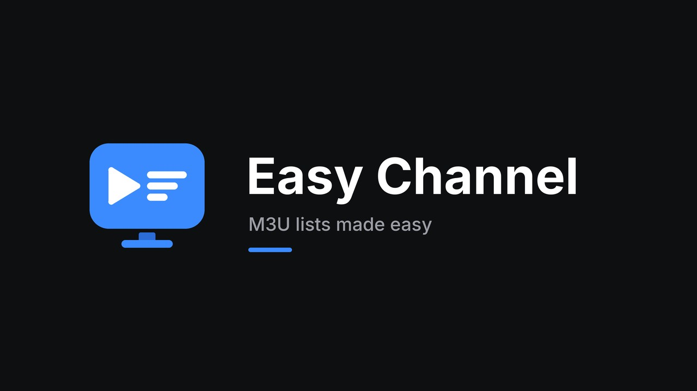
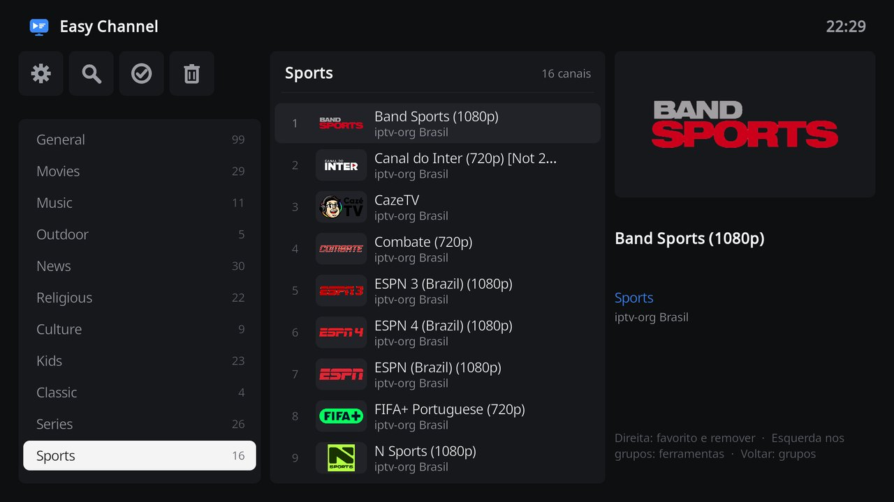
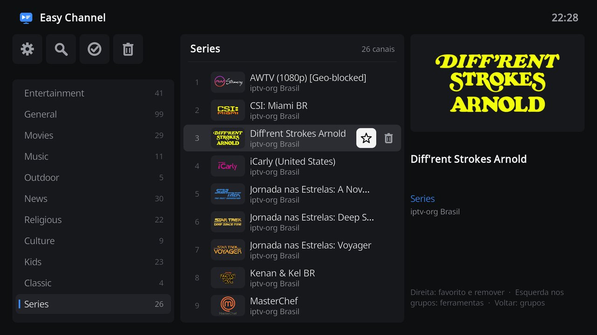
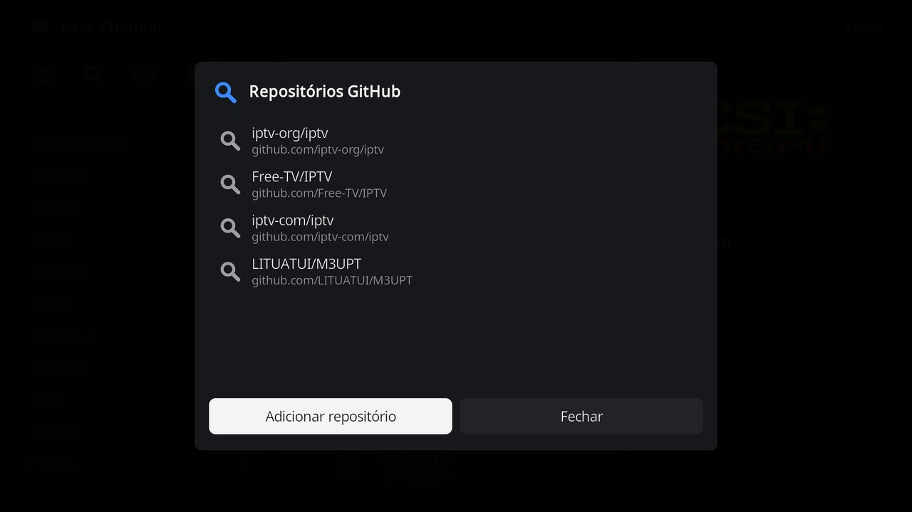

# Easy Channel

Easy Channel is a Kodi add-on for watching M3U lists in a TV box style screen. Add a list in a few steps, browse channels by group with the remote, and remove channels that no longer work as soon as they fail. Over time, your lists keep only working channels.

## Features

- TV box style screen with groups on the left, channels in the middle and details of the focused channel on the right.
- Add lists from a web address, a file on the device or network, or the M3U files of a GitHub repository. No playlist or EPG configuration is required.
- When a channel fails to open, or stops right after starting, Easy Channel offers to remove it.
- **Check channels** tests a whole group at once and removes the channels that do not respond.
- **Favorites** group at the top, kept across list updates.
- Search across all lists, restore removed channels, and export a clean M3U file for other apps.
- Selecting **TV** in Kodi's main menu opens Easy Channel.
- Interface in English and Brazilian Portuguese.

## Screenshots

| Browsing groups | Favorite and remove buttons | GitHub repositories |
| --- | --- | --- |
|  |  |  |

## Installation

1. Install the **Monteiro** repository once, following the [repository instructions](../README.md#register-the-repository-in-kodi).
2. Open **Add-ons > Install from repository > Monteiro > Video add-ons > Easy Channel** and select **Install**.

Easy Channel requires Kodi 21 (Omega) or later. It was developed and tested on LibreELEC 12.2 with Kodi 21 on a Raspberry Pi 4, using the default Estuary skin.

## Getting started

1. Open Easy Channel from **TV** in the main menu, or from **Add-ons > Video add-ons**. On first use the list manager opens automatically.
2. Add a list:
   - **GitHub** opens the suggested repositories. Select one, choose **Search lists**, and pick the lists to add. For example, search `iptv-org/iptv` with the filter `br` for Brazilian channels.
   - **Add list** accepts a web address or a file. Typing long addresses with a remote is slow. The Kore or Yatse phone apps can send text to Kodi's keyboard. You can also copy the list file to a USB drive or network share and choose **File on this device or network**.
3. Close the manager. The groups of every list appear on the left.

## Using Easy Channel

### Remote control

| Key | On the groups | On a channel |
| --- | --- | --- |
| **Up / Down** | Move between groups. The channel column follows the highlighted group. | Move between channels. |
| **Right** | Move to the channels of the group. | Move to the star, then to the trash can, then to the preview of the playing channel. |
| **Left** | Move to the toolbar, keeping the highlighted group. | Move back from the buttons, then to the groups. |
| **OK** | Move to the channels of the group. | Play the channel, or use the selected star or trash can. The channel already playing opens in full screen instead of starting again. On the preview, open full screen. |
| **Back** | Close Easy Channel. | Return to the groups. |
| **Menu** (**C** on a keyboard) | | Favorite, remove or check the channel. |

### Toolbar

The toolbar above the groups shows the name of the focused tool.

| Icon | Tool |
| --- | --- |
| Gear | **Manage lists** opens the list manager. |
| Magnifier | **Search channels** by name across all lists. |
| Check mark | **Check channels** tests every channel of the shown group. The tool shows the group name. Channels that do not respond can be removed all at once or one by one. |
| Trash can | **Removed channels** lists what you removed. Select channels to restore them. |

### Favorites

Select the star on a channel to add it to **Favorites**, the first group in the list. Favorites keep the order in which they were added, open first when Easy Channel starts, and are kept when a list is updated.

### Channels that do not work

When a channel fails to open, stops before it starts, or stops within a minute of starting, Easy Channel asks whether to **Remove** it, **Keep** it, or **Try again**. Kodi stops waiting for an unreachable server after 8 seconds, and a channel still opening after 15 seconds is checked, so a dead channel is reported in about 20 seconds.

The original M3U is never changed. Removed channels are recorded by stream address and hidden from every list, so a removal keeps working when a web list is downloaded again. Restore a channel from **Removed channels** if it works again later. **Export clean M3U** in the list manager saves a list without its removed channels.

Groups are taken from `group-title`. Channels without a group, or with a placeholder such as `Undefined`, are listed together under **Other** at the end of the groups.

## Managing lists

The list manager opens over the channel screen, and the groups behind it are reloaded after every change.

- **Add list** adds a list from a web address or a file and suggests a name.
- Select a list to **Update list**, **Rename list**, **Export clean M3U** or **Delete list**.
- **GitHub** opens the repository manager.
- **Settings** opens the add-on settings.

### GitHub repositories

**Search lists** reads every `.m3u` and `.m3u8` file of a repository and shows the ones not added yet, with their size. When a repository has more than 30 lists, a filter such as `br` narrows them first. Empty files are left out of the results. Files without channels and playlists of a single stream are skipped when adding, and the summary shows how many were skipped.

**Add repository** accepts `owner/name`, a GitHub address, or the address of a folder such as `https://github.com/iptv-org/iptv/tree/master/streams`, and searches it right away. **Delete repository** removes a repository and keeps the lists added from it.

| Suggested repository | Content |
| --- | --- |
| [iptv-org/iptv](https://github.com/iptv-org/iptv) | Publicly available channels from all over the world, one list per country. |
| [Free-TV/IPTV](https://github.com/Free-TV/IPTV) | Free TV channels only. |
| [iptv-com/iptv](https://github.com/iptv-com/iptv) | Free-to-air Brazilian channels and a world list. |
| [LITUATUI/M3UPT](https://github.com/LITUATUI/M3UPT) | TV and radio stations in Portuguese. |

These repositories are maintained by third parties. Searches use the public GitHub API, which allows about 30 searches per hour from one network.

## TV menu

Selecting **TV** in Kodi's main menu opens Easy Channel. Without a PVR add-on, Kodi shows a notice instead of the TV screen, and Easy Channel closes the notice and opens. With a PVR add-on enabled, Easy Channel opens in place of Kodi's channel list or guide. Closing Easy Channel returns to the main menu.

Turn off **Open Easy Channel from the TV menu** in the settings to use Kodi's own TV screens. Without a PVR add-on, this works with the Estuary skin, whose TV entry Easy Channel recognizes.

## Settings

| Setting | Default | Purpose |
| --- | --- | --- |
| Open Easy Channel from the TV menu | On | Open Easy Channel when **TV** is selected in Kodi's main menu. |
| Offer to remove channels that fail to play | On | Show the removal dialog after a failed playback. |
| Check the channel before playing | Off | Test each stream before opening it. Adds a short delay to every channel. |
| Update lists every (hours) | 12 | Web lists are downloaded again after this interval. The saved copy is used when the provider is offline. |
| Check timeout (seconds) | 8 | Advanced. Time to wait for each stream during a check. |
| Channels checked at the same time | 10 | Advanced. Parallel requests during **Check channels**. |

## Supported M3U features

- `#EXTINF` names with `tvg-logo`, `tvg-name` and `group-title`, including several groups separated by semicolons.
- `#EXTGRP` groups.
- `#EXTVLCOPT` user agent, referrer, origin and cookie options, sent as HTTP headers.
- `#KODIPROP` properties, such as `inputstream.adaptive` settings.
- HTTP, HTTPS and the other protocols Kodi plays. Checks only test HTTP and HTTPS streams.

## Data and privacy

Easy Channel stores its data in Kodi's add-on data folder, `userdata/addon_data/script.m3u.channels`.

| File | Content |
| --- | --- |
| `lists.json` | Added lists, with their names and addresses. |
| `cache/` | Saved copies of the lists. |
| `removed.json` | Removed channels. |
| `favorites.json` | Favorite channels. |
| `repositories.json` | GitHub repositories, once the suggested ones are changed. |

Easy Channel connects only to the addresses of your lists and streams, and to `api.github.com` and `raw.githubusercontent.com` when you search a repository. It sends no usage data.

## Known limitations

- A check confirms that a stream server answers, not that the channel plays. Channels that pass a check can still fail, and are then offered for removal after playback.
- Kodi's own dialogs, such as confirmations, selection lists and the keyboard, use the style of the current skin.
- Screenshots on a Raspberry Pi do not capture video, so the preview area appears empty in captures even while a channel plays.

## Disclaimer

Easy Channel does not provide any content. It plays the lists you add, and you are responsible for using only lists you are allowed to watch. The suggested repositories collect publicly available, free channels and are maintained by third parties, not by this project.

## Development

| Path | Purpose |
| --- | --- |
| `default.py` | Opens the main window. |
| `service.py` | Background service for the TV menu. |
| `resources/lib/gui.py` | Main window, list manager and repository manager. |
| `resources/lib/watcher.py` | Playback and failure detection. |
| `resources/lib/m3u.py` | M3U parsing and writing. |
| `resources/lib/probe.py` | Stream checks. |
| `resources/lib/github.py` | GitHub repository search. |
| `resources/lib/storage.py` | Lists, cache, favorites and removed channels. |
| `resources/lib/tv_menu.py` | TV menu service. |
| `resources/skins/default/` | Window layouts and textures. |

`m3u.py`, `probe.py` and `github.py` do not import Kodi modules and can be tested with a regular Python 3 interpreter.

Toolbar tools are declared in `TOOLS` in `resources/lib/gui.py`. Each entry has an icon from `resources/skins/default/media`, a label string, and the `MainWindow` method it runs.

The window layouts and the dark theme palette are generated by `tools/generate_m3u_channels_skin.py` in the repository root. Change colors or positions there and run it with Python 3.

The icon, fanart and header symbol are drawn by `tools/generate_easy_channel_art.py`, which needs Pillow and the [Inter](https://rsms.me/inter/) font, released under the SIL Open Font License. Pass the folder that holds `Inter-Bold.ttf` and `Inter-Medium.ttf` as its argument.

## License

MIT. See [LICENSE](LICENSE).
