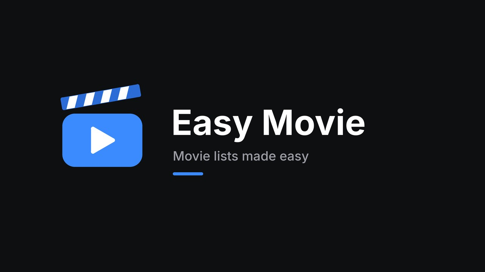
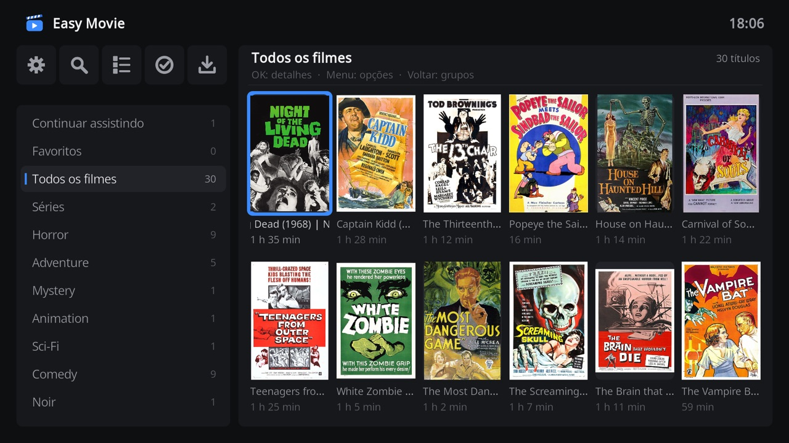
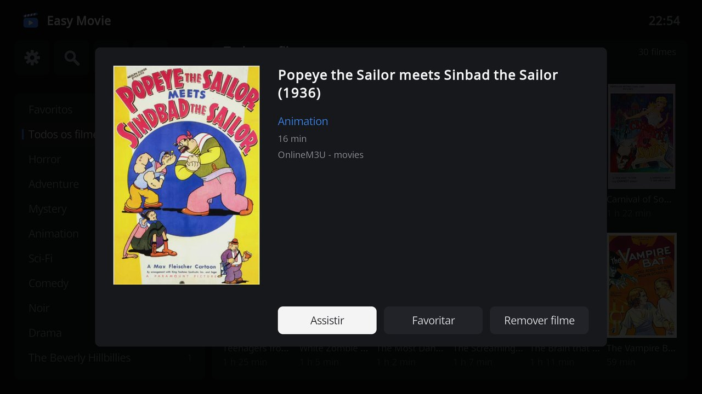
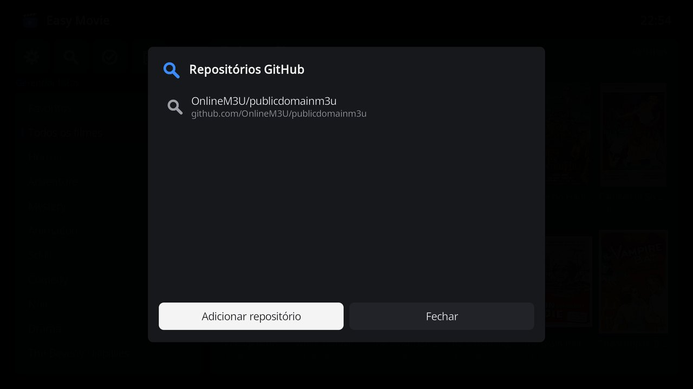
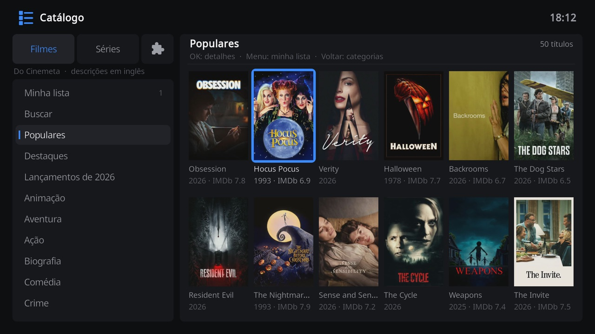
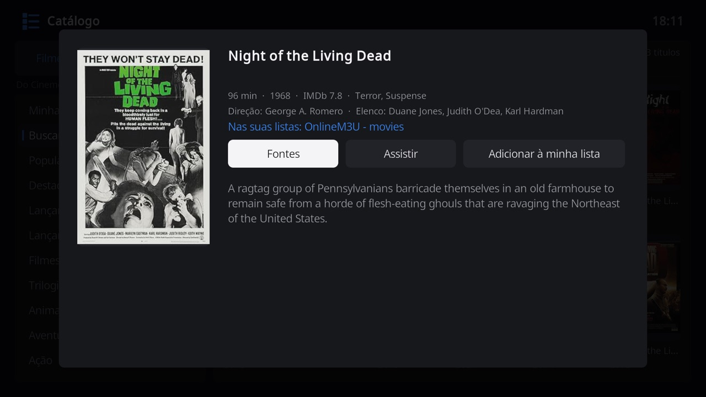
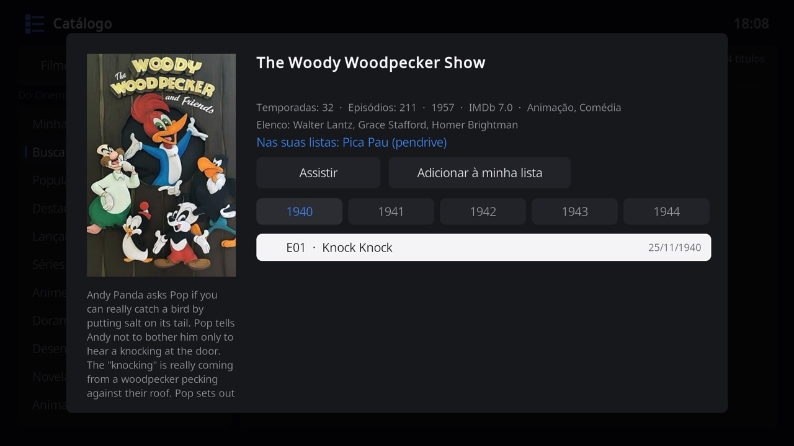
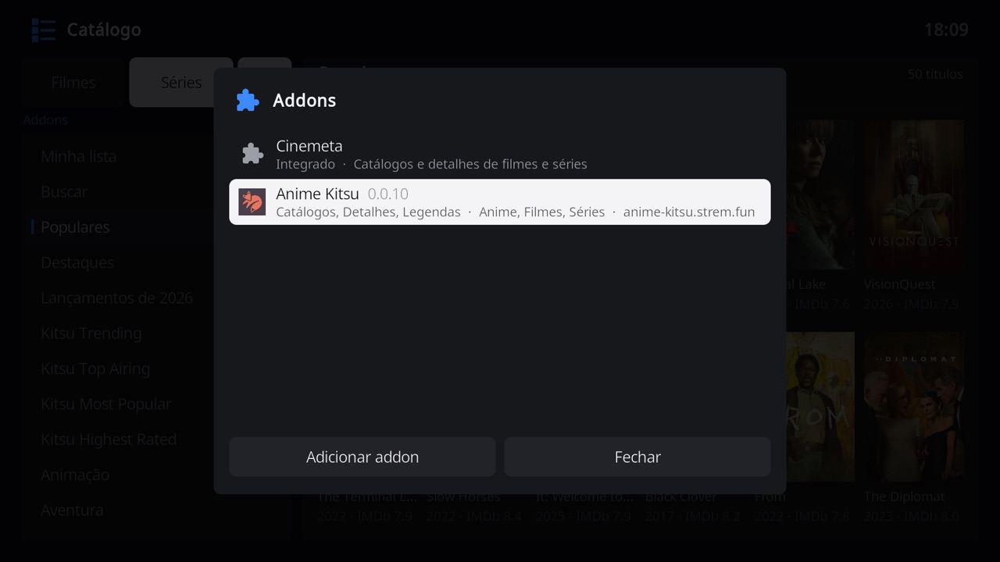

# Easy Movie

Easy Movie is a Kodi add-on that shows the movies and series of your M3U lists as a poster catalog. Add a list in a few steps, browse movies by genre with the remote, open a movie to see its details, and remove movies that no longer work as soon as they fail. It is the movie companion of [Easy Channel](../script.m3u.channels/README.md), with the same design, list manager and tools.

## Features

- One screen for everything: the groups of your lists and the catalogs of Cinemeta and of Stremio addons on the left, and six posters per row on the right, showing title and running time.
- Episodes such as `Show S01E02`, `Show 1x02` or `Show T01 E02` are grouped into one series card, with seasons, episodes and a **Continue** button for the next episode.
- Watched movies and episodes get an eye, movies and episodes stopped midway resume where you stopped, and a **Continue watching** group lists what is in progress.
- Movie details with a large poster, genre, running time and source list, and **Play**, **Favorite** and **Remove movie** buttons.
- Add lists from a web address, a file on the device or network, or the M3U files of a GitHub repository. No playlist configuration is required.
- The popular, featured and new movies and series of Cinemeta, the catalog of Stremio, and its genres, with movies and series together, after the groups of your lists. Catalog titles can be kept in **Favorites**, and those that are also in your lists play from there.
- Add Stremio addons by their address, as in Stremio. Their catalogs join the groups, and their sources open in a side panel: a torrent goes to Downloads, and a direct link plays at once or downloads.
- The details of a movie or series that is downloaded show a green check, and so do its downloaded episodes.
- Download torrents from magnet links, `.torrent` files or the catalog, and the direct links of the catalog, into a folder you choose, with a download list that shows progress, speed, time left and the free space of the folder.
- Add folders with your own video files, on the SD card, a USB drive or a network share. Posters and details come from Cinemeta, and files can be renamed or deleted from the catalog.
- Playback controls in the style of streaming apps: play and pause between back and forward 10 seconds, and the subtitle and audio tracks in a side panel. Near the end of an episode, **Next episode** plays the next one.
- Subtitles from [OpenSubtitles](https://www.opensubtitles.org), turned on automatically in your language when a movie has none, with no account needed.
- When a movie fails to open, or stops right after starting, Easy Movie offers to remove it.
- **Check movies** tests a whole genre at once and removes the movies that do not respond.
- **Favorites** genre at the top, kept across list updates.
- Search your lists and Cinemeta at once, restore removed movies, and export a clean M3U file for other apps.
- With an empty library, selecting **Movies** or **TV shows** in Kodi's main menu opens Easy Movie, on the movies or on the series.
- Interface in English and Brazilian Portuguese.

## Screenshots

| Your lists | Movie details | GitHub repositories |
| --- | --- | --- |
|  |  |  |

| Catalog | Catalog movie | Catalog series | Addons |
| --- | --- | --- | --- |
|  |  |  |  |

## Installation

1. Install the **Monteiro** repository once, following the [repository instructions](../README.md#installation).
2. Open **Add-ons > Install from repository > Monteiro > Video add-ons > Easy Movie** and select **Install**.

Easy Movie requires Kodi 21 (Omega) or later. It was developed and tested on LibreELEC 12.2 with Kodi 21 on a Raspberry Pi 4, using the default Estuary skin.

## Getting started

1. Open Easy Movie from **Movies** in the main menu, or from **Add-ons > Video add-ons**. Without lists, it opens on the popular movies of Cinemeta. To add a list, select the gear icon, **Settings**, in the toolbar.
2. Select **GitHub**, then the suggested repository `OnlineM3U/publicdomainm3u`, choose **Search lists**, and pick `movies.m3u`. You can also use **Add list** with a web address or a file.
3. Close the manager. The groups of every list appear on the left, before the catalogs, and their posters on the right.

## Using Easy Movie

### Remote control

| Key | On the groups | On a poster |
| --- | --- | --- |
| **Up / Down** | Move between groups. The posters follow the highlighted group. | Move between rows. Up on the first row moves to the toolbar. |
| **Right** | Move to the posters. | Move to the next poster. |
| **Left** | Move to the toolbar, keeping the highlighted group. | Move to the previous poster. In the first column, return to the groups. |
| **OK** | Move to the posters. | Open the details. |
| **Back** | Close Easy Movie. | Return to the groups. |
| **Menu** (**C** on a keyboard) | | Favorite, remove or check a movie of your lists, or add a catalog title to **Favorites** or remove it. |

### Groups

| Group | Content |
| --- | --- |
| **Continue watching** | Movies stopped midway and series with episodes left, most recent first. |
| **Favorites** | Your favorite movies and series of the lists, then the catalog titles you added, newest first. A catalog title that is also in your lists shows once, as the movie or series of the lists. |
| **My movies** / **My series** | Every movie and series of your lists and folders, newest first. |
| Genres of your lists | The `group-title` of the lists, and the subfolders of video folders, ending with **Other**. |
| **Popular**, **Featured** and the year's movies and series | The most watched titles of Cinemeta right now, those it picks, and those released this year, movies and series apart. |
| Catalogs of addons | The catalogs of the addons you added, in the order of each addon, such as **Netflix · Movies**. The header names the addon. |
| Genres of Cinemeta | Popular movies and series of each genre together, from Action to Western, and Reality show, Talk show and Game show for series. |

Easy Movie opens on **Continue watching**, **Favorites** or **My movies**, the first that has titles, or else on the popular movies. The groups of the catalog load about 50 titles at a time, and the next ones load when the selection nears the last row. Loaded groups are kept while Easy Movie is open, so returning to one is instant.

### Movie details

The details window shows the poster, title, genre, running time and source list. **Play** starts the movie, **Favorite** adds it to or removes it from **Favorites**, and **Remove movie** removes it after confirmation. **Back** closes the window.

Running time comes from the `#EXTINF` duration in seconds. Lists that use `-1` show no running time.

### Series

Episodes are recognized by their name and grouped into series. The text before the episode code is the series name, so `Breaking Bad S01E02 - Cat's in the Bag` becomes episode 2 of season 1 of **Breaking Bad**, titled *Cat's in the Bag*. When a name is only `S01E01`, the `group-title` is used as the series name. Episodes of the same series from different lists are shown together.

| Recognized codes | Example |
| --- | --- |
| `SxxEyy` | `Show S01E02`, `Show s1e2`, `Show S01 E02` |
| `TxxEyy` | `Show T01E02`, `Show T1 E2` |
| `NxNN` | `Show 1x02` |
| Words | `Show Temporada 1 Episódio 2`, `Show Season 1 Episode 2` |
| Season and episode with a bar | `T01\|EP02`, `01\|EP02`, `3\|EP02 Title`, `T01\|02` |

Some lists keep the series name in a `pltv-subgroup` attribute and name episodes only with a code, as in `pltv-subgroup="30 Rock",T01|EP01`. Easy Movie then uses `pltv-subgroup` as the series name, which also replaces abbreviations such as `BBAT T1|EP01`. With `pltv-subgroup`, names made only of an episode number, as `EP001`, become episodes of season 1, and `T03|ESPECIAL` becomes a special of season 3. For movies, the same attribute usually holds the genre, so it is added to the movie genres.

The same stream in several lists is shown once. Episodes with the same code but different streams are all kept, in the order of the list, because some lists give several episodes the same number.

Opening a series shows its poster, seasons and episodes. **Continue** plays the next episode: the one stopped midway, or the first unwatched episode after the last one watched. Select a season and an episode to play any other episode. **Remove series** removes all its episodes.

When the series is known to the catalog, as a series downloaded from its sources or a series of a video folder with Cinemeta details, its details list every episode of the catalog, also those that are not in your lists. A downloaded episode has a green check, and a watched one an eye before its date. An episode in your lists plays, and the others open their [sources](#sources), to download them or watch them at once. The episodes of the catalog load a moment after the details open.

The series of your lists that are one title of Cinemeta show as one series, as a series downloaded in part from Cinemeta and in part from an addon that names it in Portuguese. The one with the most episodes keeps its name and poster. A title downloaded from an addon is looked up on Cinemeta by its name and year.

### Progress and Continue watching

Easy Movie remembers how far each movie and episode was watched. Playing past 90% marks it as watched, shown with an eye. A movie or episode stopped after the first minute offers **Resume** or **Play from the beginning** the next time.

The groups start with **Continue watching**, with movies stopped midway and series with episodes left, most recent first, followed by **Favorites**, **All movies** and **Series**. **All movies** and the genres show the newest movies first, such as a finished download. Movies that arrived together keep the order of their lists. Easy Movie opens on **Continue watching** when it has items.

### Playback controls

Movies and episodes play with the controls of Easy Movie, in the style of streaming apps. They show the title, a time bar, **Subtitles** and **Audio** on the sides, and play and pause between back and forward 10 seconds. The controls hide after 5 seconds without a key, and stay while the movie is paused.

| Key | Controls hidden | Controls shown |
| --- | --- | --- |
| **OK**, **Up**, **Down**, **Info**, **Menu**, **Fast forward** or **Rewind** | Show the controls. | Use the highlighted button. |
| **Left / Right** | Go back or forward 10 seconds, showing the controls with the back or forward button lit. Presses add up, so three presses skip 30 seconds, and the arrows keep skipping until the controls hide. | Move between the buttons. |
| **Back** | Stop the movie. Its progress is kept. | Hide the controls. |
| **Play / Pause**, **Stop**, volume | Work as usual in Kodi. | Work as usual in Kodi. |

In the last minute of an episode, or the last tenth of a short one, the controls show with **Next episode** above the time bar, with the season and number of the next episode of your lists, when there is one. It has the focus, so **OK** plays it, and the controls stay while it is offered. **Back** hides the controls and puts the button away for the rest of the episode. From the other buttons, **Up** reaches it. The next episode starts where it stopped when it was started before. It does not play by itself when the episode ends.

**Subtitles** lists the subtitles of the video and subtitle files next to it, such as `Movie.pt-BR.srt`, with **Off** first. **Audio** lists the audio tracks, such as the Portuguese and English tracks of a dual audio release. The current track has a check mark. Select a track with **OK**, or close the panel with **Back**.

Turn off **Easy Movie player controls** in the settings to use the controls of the Kodi skin instead.

### Online subtitles

Subtitles come from [OpenSubtitles](https://www.opensubtitles.org), the largest collection of subtitles made by its community, through OpenSubtitles v3, the subtitles addon of Stremio. No account is needed.

When a movie or an episode starts, Easy Movie looks up its subtitles in the background. When the audio is in another language than the **Subtitle language** setting, Brazilian Portuguese at first, it turns on a subtitle in that language and shows **Subtitle in Portuguese (Brazil)**:

1. A subtitle of the video itself, or a subtitle file next to it, comes first.
2. Otherwise the best subtitle online is downloaded. For a video file on the device, its OpenSubtitles hash finds the subtitles made for that very file, shown as **Made for this file**. The others come by the likeness of their release name to the file name.
3. Languages are tried in order: Brazilian Portuguese, then Portuguese, then English. Choosing Portuguese, English or Spanish in the setting changes the order.

A movie with Portuguese audio, such as a dubbed release, gets no subtitle. The subtitles online are also listed in **Subtitles**, after the tracks of the video, with their release name. When a subtitle is out of sync, pick another one there. Turn off **Download subtitles automatically** to only list them.

The movie is found by its IMDb id, which Cinemeta gives for the videos of folders and the catalog. Movies of web lists are first looked up on Cinemeta by their name and year. Downloaded subtitles are kept in the `subtitles` folder of the add-on data only while their movie plays.

### Toolbar

The toolbar above the genres shows the name of the focused tool.

| Icon | Tool |
| --- | --- |
| Magnifier | **Search movies and series** by title in your lists, whose results show first, and in Cinemeta. |
| Check mark | **Check movies** tests every movie of the shown group of your lists. The tool shows the group name. Movies that do not respond can be removed all at once or one by one. The groups of the catalog are not checked. |
| Puzzle piece | **Addons** opens the Stremio addons. See [Addons](#addons). |
| Gear | **Settings** opens the list manager, with the settings of Easy Movie. See [Managing lists](#managing-lists). |
| Download arrow | **Downloads** opens the torrent download manager. See [Downloads](#downloads). |

### Movies that do not work

Before playing, Easy Movie checks that the stream answers, with a **Connecting** dialog that can be cancelled. The details window stays open meanwhile, so another episode can be picked right away. Kodi itself waits for an unresponsive server on its interface thread, which froze the screen for half a minute, so streams that do not answer are reported before Kodi tries them. A stream that answers is checked in about two seconds, and most open without the dialog appearing. A stream that does not answer is reported within 8 seconds, the **Check timeout** setting, with **Remove**, **Cancel** or **Play anyway**.

When a movie fails to open, stops before it starts, or ends within a minute of starting without reaching its end, Easy Movie asks whether to **Remove** it, **Keep** it, or **Try again**. For a video file of a folder, it says that the file may be incomplete, as after a copy or a download that was interrupted: its player reaches the end of the data when it plays or skips past it. Kodi stops waiting for an unreachable server after 8 seconds, and a movie still opening after 15 seconds is checked, so a dead link is reported in about 20 seconds. Stopping a movie after it started is never treated as a failure.

The original M3U is never changed. Removed movies are recorded by stream address and hidden from every list, so a removal keeps working when a web list is downloaded again. Restore a movie from **Removed movies** in the list manager if it works again later. **Export clean M3U** in the list manager saves a list without its removed movies.

Genres are taken from `group-title`. Movies without a genre, or with a placeholder such as `Undefined`, are listed together under **Other** at the end of the genres. Posters come from `tvg-logo`. Movies without a poster show a clapperboard.

## Video folders

Select **Add list** > **Folder with videos** to add a folder with your own video files, such as `/storage/videos`, a USB drive under `/var/media`, or a network share such as `smb://`. The folder becomes a list like the others. A folder on this device, such as a USB drive, is read again each time Easy Movie opens and when Downloads closes, so new videos and finished downloads show at once. A network share is read again with the web lists, or with **Update list** after you add or remove files.

- Each first level subfolder with more than one movie or series becomes a genre, such as `Movies` or `Cartoons`. The folder of a single movie or series, as a torrent download makes, is not a genre, nor is a folder named after one of its titles, as `Pepper Chocolate` with episodes downloaded under two names.
- File names are cleaned for display: `O.Senhor.dos.Aneis.2001.1080p.BluRay.mkv` appears as **O Senhor dos Aneis (2001)**.
- Episodes are recognized by their codes, such as `Show.S01E02.mkv`, and take the name of their series from their folder. A folder where most files start with a number, such as `Pica Pau/196 - Adeus As Aulas.mp4`, is a series whose episodes are those numbers. Folders named `Season 2` or `Temporada 2` give the season.
- A poster is taken from an image next to the video with the same name, from `poster.jpg`, `folder.jpg` or `cover.jpg` in the folder of a series or of a movie alone in its folder, or else from Cinemeta. Without any, Kodi shows a frame of the video.
- Subtitles with the same name as the video, such as `Movie.srt` or `Movie.pt-BR.srt`, are loaded by Kodi.
- Files of macOS (`._*` and `.DS_Store`) and sample videos are ignored.
- While the drive of a folder is disconnected, its videos are hidden. Their progress and favorites are kept for when it comes back.

### Cinemeta details

Easy Movie looks up each movie and series of a folder on [Cinemeta](https://v3-cinemeta.strem.io), the metadata service of Stremio, and shows its poster, year, IMDb rating, genres, running time and description. Titles in Portuguese are found, and descriptions are in English. Lookups run in the background the first time a video appears, and the results are saved.

When a video gets the wrong details, open its menu (**Menu** or **C**) and select **Choose info**. Edit the search if needed, then pick the right result or **No info**.

### Renaming and deleting files

The menu of a video of a folder also offers:

| Option | What it does |
| --- | --- |
| **Rename file** | Renames the video and the files with its name next to it, such as subtitles and posters. Progress and favorites follow the new name. |
| **Delete file** / **Delete series files** | Deletes the video, or all episodes of a series, with the files that have their names, after a confirmation. |
| **Remove movie** / **Remove series** | Hides the video from the catalog without deleting it. **Removed movies** in the list manager restores it. |

Renaming and deleting need a drive that can be written. A drive formatted as NTFS that was not removed safely may be mounted read only. Easy Movie then reports that the files could not be changed.

## Catalog

After the groups of your lists come the movies and series of [Cinemeta](https://v3-cinemeta.strem.io), the metadata service of Stremio, and the catalogs of the [addons](#addons) you added. See [Groups](#groups).

Select a poster to open its details: poster, year, IMDb rating, genres, running time, director, cast and description. A series also shows its seasons and episodes with their air dates, and the description below the poster follows the highlighted episode. **Add to favorites** saves the title in **Favorites**, where it then shows a star, and **Menu** on a poster does the same without opening it.

When the title is also in your lists, found by the Cinemeta details of a video folder or by name and year, the details show **In your lists** with the list name and a **Play** button, which opens the movie or series from your lists. Descriptions are in English.

When the title is downloaded, a green check shows on its poster and before **Downloaded**, or the number of episodes downloaded of a series, and each downloaded episode has a green check. A title is downloaded when it is in a video folder of your lists, or when a download from its sources ended, in whichever folder it is. The details of a movie or series of a video folder show the same check.

### Sources

When an addon that gives sources is installed, movie details have a **Sources** button, and selecting an episode of a series does the same for that episode. A panel slides in from the right with the sources of every addon, asked at the same time and listed as they answer, in the order the addons were added.

Each source shows its file or release name, and whether it is a **Torrent** or a **Direct link**, with its quality, audio languages, size, seeds and addon when the addon gives them. Addons mark languages with flags, shown as language codes, as in `EN RU` or `PT-BR`.

- **Torrent**: goes to [Downloads](#downloads), into the download folder. When it is a pack of a whole season or collection, only the chosen file is downloaded. Easy Movie waits for the torrent details, then stops the other files.
- **Direct link**, with the play icon: OK offers **Watch now**, which plays it at once with the request headers the addon asks for, or **Download**. A download goes to [Downloads](#downloads), into the download folder, named after the title: an episode as `Series/Series S01E02.mp4`, a movie as `Movie (1999).mp4`. It continues after a lost connection and after Easy Movie closes, and shows in the catalog with the poster of its title once it ends. A live stream made of segments, as HLS, cannot be saved, and Easy Movie says so.

**Left** or **Back** closes the panel. When the download folder has less free space than the torrent needs, Easy Movie names the folder, its free space and the size of the torrent, and offers **Change folder**.

### Addons

The puzzle piece in the toolbar opens **Addons**, the Stremio addons whose catalogs and sources Easy Movie uses. A Stremio addon is a web address that describes itself in a `manifest.json` file and answers with catalogs, details, sources or subtitles.

- **Cinemeta** is built in and always listed first.
- **Add addon** asks for the address of an addon. Paste its `manifest.json` address, the address without `manifest.json`, or a `stremio://` install link. Typing an address with the remote is slow, so paste it from a phone with [Kore](https://kodi.wiki/view/Kore) or Yatse while the keyboard is open.
- Each addon shows its logo, version, what it gives (catalogs, details, sources, subtitles), for which types, and its server.
- Select an addon to **Update addon**, which reads its manifest again, or **Remove addon**.
- An addon that must be configured first, such as one that asks for a language or an account, shows the address of its configuration page. Configure it there on a phone or computer, and add the address it gives.

The catalogs of an addon that can be shown without a search or a genre appear in the groups, after the ones of Cinemeta. Catalogs of movies and series with the same name, as Netflix, show their type, and a catalog without a name takes the name of its addon. Their titles open with the details of the addon when it gives them, or of Cinemeta. The sources of addons are listed in [Sources](#sources).

## Downloads

The download icon at the end of the toolbar opens **Downloads**, the manager of torrents and of the direct links downloaded from the catalog.

- **Add magnet link** asks for a magnet link or the web address of a `.torrent` file. Typing a long link with the remote is impractical, so paste it from a phone with a remote app such as Kore or Yatse while the keyboard is open.
- **Add .torrent file** picks a `.torrent` file, for example one copied to a USB drive.
- **Change folder** chooses where downloads are saved. On LibreELEC, a folder on the SD card asks for confirmation first, since downloads write a lot and wear cards out. Use a USB drive or hard disk instead.
- The list shows each download with its progress, state, speed, connections, size and time left, and updates every two seconds. When it does not fit, a scroll bar on its right shows how near its end the selection is. The header shows the total download and upload speeds, and the folder line its free space.
- The engine pauses downloads when the folder is full. They then show **No space left in the folder** instead of paused, and resume after space is freed and they are resumed.
- Select a download, or press **Menu**, to **Pause** or **Resume** it, **Remove from the list**, or **Remove and delete files**.

Downloads keep going after the screen is closed, while Kodi runs. When Kodi starts, unfinished downloads resume. Add the download folder as a video folder to see what you downloaded in the catalog.

Torrent downloads also upload to other people while they run. The upload speed is limited in the settings. You are responsible for what you download.

### Torrent engine

Easy Movie downloads with [Torrest](https://github.com/i96751414/torrest-cpp) 0.0.8, a torrent engine built on libtorrent with a REST API, released under the MIT license. Its executables for Linux (arm64, armv7, x64, x86), Android (arm64, arm, x64, x86), Windows (x64, x86) and macOS (x64, which Apple silicon Macs run with Rosetta) are in `resources/bin`, with its license and their SHA-256 checksums. Easy Movie copies the one of the device into its data folder, starts it as a separate process on port 61235 when **Downloads** opens or when Kodi starts with unfinished downloads, and stops it when Kodi quits. A failure of the engine does not stop Kodi.

## Managing lists

The list manager opens over the catalog, and the genres behind it are reloaded after every change.

- **Add list** adds a list from a web address or a file, or a folder with videos, and suggests a name.
- Select a list to **Update list**, **Rename list**, **Export clean M3U** or **Delete list**.
- **GitHub** opens the repository manager.
- **Removed movies** lists what you removed. Select movies to restore them.
- **Settings** opens the add-on settings.

### GitHub repositories

**Search lists** reads every `.m3u` and `.m3u8` file of a repository and shows the ones not added yet, with their size. When a repository has more than 30 lists, a filter narrows them first. Empty files are left out of the results. Files without movies and playlists of a single stream are skipped when adding, and the summary shows how many were skipped.

**Add repository** accepts `owner/name`, a GitHub address, or the address of a folder, and searches it right away. **Delete repository** removes a repository and keeps the lists added from it.

| Suggested repository | Content |
| --- | --- |
| [OnlineM3U/publicdomainm3u](https://github.com/OnlineM3U/publicdomainm3u) | Public domain movies and TV shows hosted by the Internet Archive, with posters and genres. |

The repository is maintained by a third party. Searches use the public GitHub API, which allows about 30 searches per hour from one network.

## Movies and TV shows menus

When Kodi's movie library is empty, selecting **Movies** in Kodi's main menu opens Easy Movie instead of the empty video sources. When the TV show library is empty, **TV shows** opens Easy Movie on the **Series** group. Closing Easy Movie returns to the main menu. When a library has content, Kodi's own screens open as usual.

Turn off **Open Easy Movie from the Movies menu** or **Open Easy Movie from the TV shows menu** in the settings to keep Kodi's behavior. This works with the Estuary skin, whose Movies and TV shows entries Easy Movie recognizes.

## Settings

| Setting | Default | Purpose |
| --- | --- | --- |
| Open Easy Movie from the Movies menu | On | Open Easy Movie when **Movies** is selected in Kodi's main menu and the movie library is empty. |
| Open Easy Movie from the TV shows menu | On | Open Easy Movie on the series when **TV shows** is selected and the TV show library is empty. |
| Easy Movie player controls | On | Show the controls of Easy Movie over movies and episodes. Off uses the controls of the Kodi skin. |
| Download subtitles automatically | On | Turn on a subtitle from OpenSubtitles when a movie has none in the subtitle language. |
| Subtitle language | Portuguese (Brazil) | Language of the online subtitles: Portuguese (Brazil), Portuguese, English or Spanish. English is also tried after the other languages. |
| Offer to remove movies that fail to play | On | Show the removal dialog after a failed playback. |
| Look up posters and details of folder videos on Cinemeta | On | Fetch posters and details of the movies and series of video folders. |
| Download folder | Not set | Folder for torrent downloads. **Downloads** asks for it the first time. |
| Upload limit (KB/s, 0 for no limit) | 200 | Maximum upload speed of torrent downloads. |
| Resume downloads when Kodi starts | On | Start the torrent engine with Kodi when there are unfinished downloads. |
| Update lists every (hours) | 12 | Web lists are downloaded again after this interval. The saved copy is used when the provider is offline. |
| Check timeout (seconds) | 8 | Advanced. Time to wait for each stream during a check. |
| Movies checked at the same time | 10 | Advanced. Parallel requests during **Check movies**. |

## Supported M3U features

- `#EXTINF` duration, names with `tvg-logo`, `tvg-name` and `group-title`, including several genres separated by semicolons.
- `#EXTGRP` groups.
- `#EXTVLCOPT` user agent, referrer, origin and cookie options, sent as HTTP headers.
- `#KODIPROP` properties, such as `inputstream.adaptive` settings.
- HTTP, HTTPS and the other protocols Kodi plays. Checks only test HTTP and HTTPS streams.

## Data and privacy

Easy Movie stores its data in Kodi's add-on data folder, `userdata/addon_data/script.m3u.movies`, separate from Easy Channel.

| File | Content |
| --- | --- |
| `lists.json` | Added lists, with their names and addresses. |
| `cache/` | Saved copies of the lists. |
| `removed.json` | Removed movies. |
| `favorites.json` | Favorite movies and series. |
| `progress.json` | Playback position and watched state of movies and episodes. |
| `added.json` | When each movie first appeared in the lists, for showing the newest first. |
| `metadata.json` | Cinemeta details of the movies and series of video folders. |
| `watchlist.json` | Catalog titles added to **Favorites**. |
| `addons.json` | Stremio addons added in **Addons**, with their addresses and manifests. |
| `torrest/` | The torrent engine, its settings, log and saved downloads. |
| `subtitles/` | Subtitles downloaded from OpenSubtitles for the movie playing. |
| `repositories.json` | GitHub repositories, once the suggested one is changed. |

Easy Movie connects only to the addresses of your lists, streams and posters, to `api.github.com` and `raw.githubusercontent.com` when you search a repository, to `v3-cinemeta.strem.io` and `cinemeta-catalogs.strem.io` to look up the videos of folders, sending their titles, and to show the catalog and its searches, to `opensubtitles-v3.strem.io` and the `strem.io` servers of its files for subtitles, sending the IMDb id of the movie or episode, the name of its file and the OpenSubtitles hash of the file, which is computed from its size and its first and last 64 KB, to the addresses of the Stremio addons you add, and, for torrent downloads, to the trackers and peers of the torrents you add. The Cinemeta lookups of folders and the automatic subtitles can be turned off in the settings. It sends no usage data.

## Known limitations

- A check confirms that a stream server answers, not that the movie plays. Movies that pass a check can still fail, and are then offered for removal after playback.
- Series are recognized by episode codes in the names. Episodes without a code are shown as movies.
- Kodi's own dialogs, such as confirmations, selection lists and the keyboard, use the style of the current skin.
- The catalog shows catalogs of movies, series and anime. Catalogs of live TV and catalogs that need a search or a genre are left out. Addon searches are not used yet: **Search** searches your lists and Cinemeta.
- Direct links from addons play without saving progress, and their titles are not marked as watched. They also play with the controls of the Kodi skin.
- Online subtitles depend on the OpenSubtitles v3 service of Stremio, which may change. A subtitle of another release of the movie can be out of sync. Rare and very new titles may have none in Portuguese.
- While a movie is paused, the Kodi skin also shows its own time bar at the top of the screen. Subtitles are drawn behind the playback controls while these are shown.
- Downloading only one file of a pack needs Easy Movie to stay open until the torrent details arrive, usually a few seconds. When it is closed before, the whole pack downloads. Remove it in **Downloads** and choose the source again.

## Disclaimer

Easy Movie does not provide any content. It plays the lists you add, and you are responsible for using only lists you are allowed to watch. The suggested repository lists public domain movies and is maintained by a third party, not by this project.

The catalog comes with Cinemeta only, which gives posters and details, not videos. Easy Movie includes no addon with sources. The Stremio addons you add, and what you download or play from them, are your choice and your responsibility.

## Development

Easy Movie shares its design and most of its code with Easy Channel. Each add-on keeps its own copy, as the repository conventions ask for self-contained add-ons. `m3u.py`, `probe.py`, `github.py` and `storage.py` are the same modules, with the defaults and the `#EXTINF` duration that movies need. `watcher.py` also records progress, and `series.py` is specific to Easy Movie. `series.py`, `folders.py`, `cinemeta.py`, `stremio.py`, `subtitles.py` and `torrents.py` do not import Kodi modules and can be tested with a regular Python 3 interpreter.

| Path | Purpose |
| --- | --- |
| `default.py` | Opens the main window. |
| `service.py` | Background service for the Movies and TV shows menus. |
| `resources/lib/gui.py` | Main window with the groups of the lists and the catalogs, movie and series details, the details of catalog titles, sources, addons, downloads, list manager and repository manager. |
| `resources/lib/series.py` | Episode recognition and grouping into series. |
| `resources/lib/folders.py` | Video folders: finds the videos and describes them as an M3U list. |
| `resources/lib/cinemeta.py` | Cinemeta catalogs, search, details and episodes. |
| `resources/lib/stremio.py` | Stremio addons: manifests, catalogs, details and sources. |
| `resources/lib/torrents.py` | Torrent engine: starts Torrest and uses its API. |
| `resources/bin/` | Torrest executables for each platform, with their license and checksums. |
| `resources/lib/watcher.py` | Playback, progress and failure detection. |
| `resources/lib/controls.py` | Playback controls over the video, with the subtitle and audio tracks, the online subtitles and the next episode button. |
| `resources/lib/subtitles.py` | OpenSubtitles search, ranking, file hash and download. |
| `resources/lib/m3u.py` | M3U parsing and writing. |
| `resources/lib/probe.py` | Stream checks. |
| `resources/lib/github.py` | GitHub repository search. |
| `resources/lib/storage.py` | Lists, cache, favorites and the catalog titles of Favorites, removed movies, progress, Cinemeta details and addons. |
| `resources/lib/movies_menu.py` | Movies and TV shows menu service. |
| `resources/skins/default/` | Window layouts and textures. |

Toolbar tools are declared in `TOOLS` in `resources/lib/gui.py`.

The window layouts are generated by `tools/generate_m3u_movies_skin.py` in the repository root, which reuses the palette, toolbar, genres and managers of `tools/generate_m3u_channels_skin.py`. A palette change in the Easy Channel generator applies to both add-ons after running both scripts.

The icon, fanart, header symbol and poster placeholder are drawn by `tools/generate_easy_movie_art.py`, with the colors and shapes of Easy Channel's artwork. It needs Pillow and the [Inter](https://rsms.me/inter/) font, released under the SIL Open Font License. Pass the folder that holds `Inter-Bold.ttf` and `Inter-Medium.ttf` as its argument.

## License

MIT. See [LICENSE](LICENSE).
